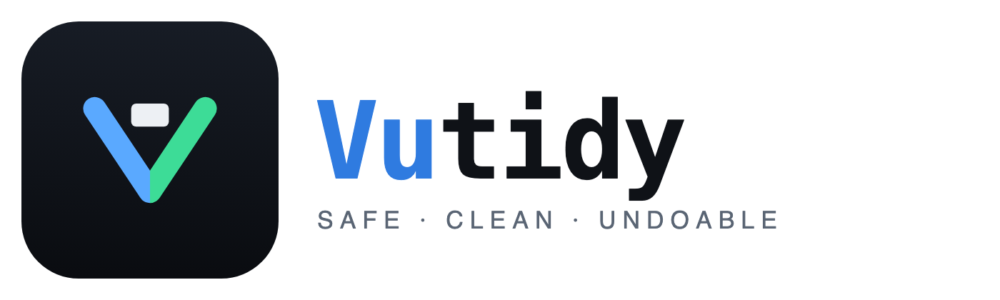
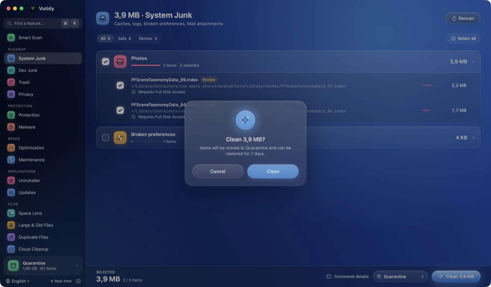
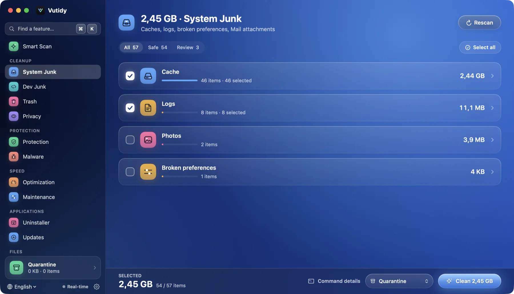
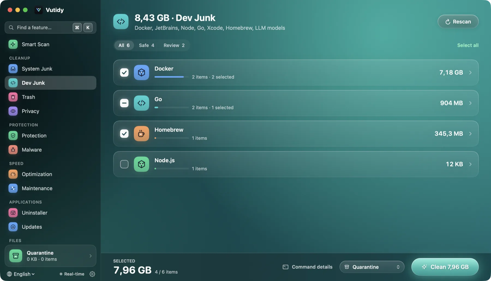
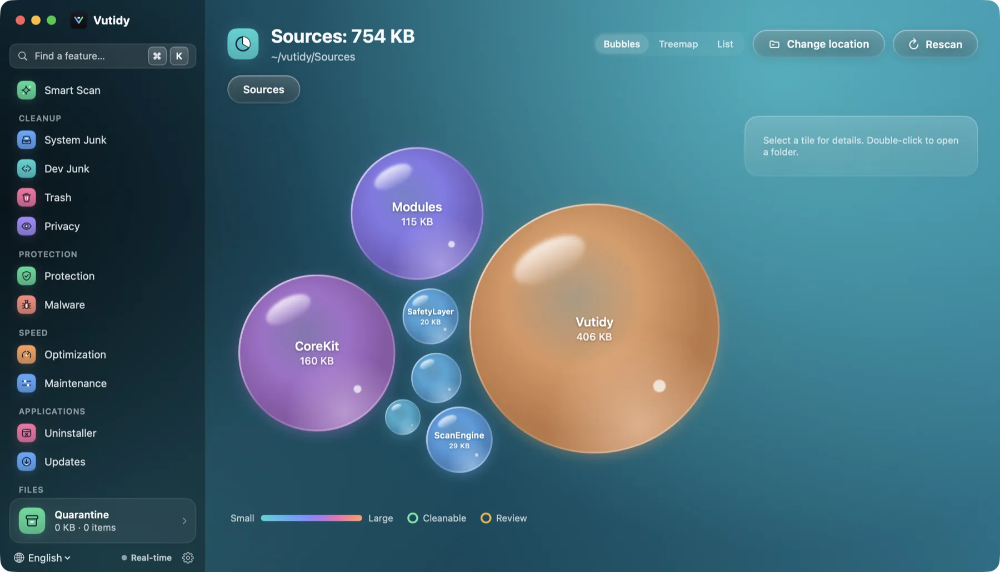
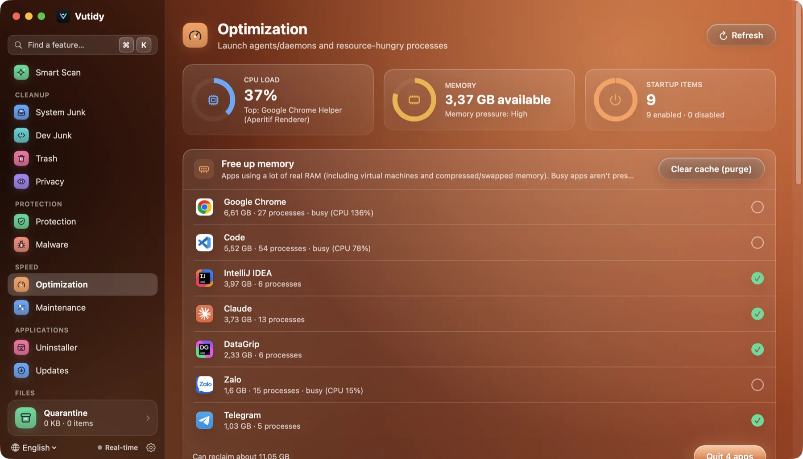

<p align="center"></p>

<p align="center">
  <b>Vutidy is a free, open-source cleaner and optimizer for macOS that shows you exactly what it will remove, and lets you undo it.</b>
</p>

<p align="center">
  <a href="https://github.com/vunguyenvu35/vutidy/releases/latest/download/vutidy-macos.dmg"></a>
  &nbsp;
  <a href="https://github.com/vunguyenvu35/vutidy/releases/latest"></a>
</p>

<p align="center"><sub>macOS 13 or later · Apple silicon and Intel · free · no account · no telemetry<br>macOS says the app "can't be opened"? Builds are not notarized yet: <a href="docs/getting-started/install-macos.md#open-an-app-that-is-not-notarized"><b>how to open it in four clicks</b></a>.</sub></p>

<p align="center"></p>

## Why Vutidy

- **You see what goes before it goes.** Every page lists each item with its path, or the exact command it would run (`docker image prune -f`, `brew cleanup`…). **Preview (dry-run)** does the same steps and changes nothing.
- **Cleaning is undoable.** By default items move to a **Quarantine** you can restore from for 7 days, with the original path and permissions. Nothing is deleted for good unless you choose that.
- **Built for developers, too.** Docker images and build cache, JetBrains and Xcode leftovers, Node, Go, Python, PHP, Homebrew, Gradle, Cargo, Ollama and Hugging Face models, and `node_modules` in projects you have not touched for weeks.
- **A hard safety layer.** A blocklist that no rule can override keeps `~/Documents`, `~/Desktop`, keychains, `.ssh` and system folders out of reach. Running apps are skipped. Every deletion is written to an audit log.
- **Private by design.** No account, no telemetry, nothing about your Mac is uploaded. The only automatic request is the optional update check, which asks GitHub for the newest version number.
- **Native and light.** Swift and SwiftUI, a menu bar popover that keeps watching your Mac, and a `vutidy-cli` for the terminal. In English, Tiếng Việt, 日本語 and 中文.

## What you can do

| | |
| --- | --- |
| **Scan everything in one click** | **Smart Scan** looks at System Junk, Dev Junk, Trash, launch items and heavy processes together, then lists what *Clean* will take (only items marked *Safe*). |
| **Clean up** | **System Junk** (caches, logs, crash reports, Mail and Photos caches), **Dev Junk**, **Trash** and **Privacy** (browser caches; never history or passwords). |
| **Find where the space went** | **Space Lens** (bubbles, treemap or list; area = size), **Large & Old Files**, **Duplicates** (size, then hashes) and iCloud **Cloud Cleanup**. |
| **Remove apps completely** | **Uninstaller** finds leftovers by bundle ID. **Updates** upgrades your Homebrew casks. |
| **Speed up** | **Optimization**: CPU and memory gauges, memory-hungry apps you can quit, startup items on or off. **Maintenance**: DNS, Spotlight, Time Machine snapshots, Launch Services. |
| **Keep an eye on things** | **Protection**: a launch-item scanner with code-signature checks and a real-time monitor of sensitive folders. It is **not** an antivirus. |
| **Stay in the menu bar** | Disk, memory, CPU, battery, network, a speed test and recommendations, one click away. |
| **Work from the keyboard** | A shortcut for every page that you can change, and a Quick Open palette (⌘K). |
| **Update itself** | Check for a new version and update from inside the app, after it verifies the checksum and signature. |

<table>
  <tr>
    <td width="50%"><br><sub>Category cards, safety filters and an action bar with the commands to run</sub></td>
    <td width="50%"><br><sub>Dev Junk: what your developer tools leave behind</sub></td>
  </tr>
  <tr>
    <td><br><sub>Space Lens: the biggest folders are the biggest bubbles</sub></td>
    <td><br><sub>Optimization: gauges, memory-hungry apps and startup items</sub></td>
  </tr>
</table>

## Try it

**Requirements:** macOS 13 (Ventura) or later, Apple silicon or Intel. Vutidy is a pre-release: read the [known issues](RELEASE_NOTES.md#known-issues) first.

### 1. Install

| Download (always the newest release) | How to install |
| --- | --- |
| [**`vutidy-macos.dmg`**](https://github.com/vunguyenvu35/vutidy/releases/latest/download/vutidy-macos.dmg) (recommended) | Open the DMG and drag **Vutidy** onto *Applications*. |
| [`vutidy-macos.zip`](https://github.com/vunguyenvu35/vutidy/releases/latest/download/vutidy-macos.zip) | Unzip it and move **Vutidy.app** to *Applications*. |
| [`SHA256SUMS`](https://github.com/vunguyenvu35/vutidy/releases/latest/download/SHA256SUMS) | Check a download: `shasum -a 256 -c SHA256SUMS --ignore-missing`. |

The links always point to the newest release. Every release also has the same files with the version in their name (`vutidy-<version>-macos.dmg`), for an older version, on the [Releases page](https://github.com/vunguyenvu35/vutidy/releases). To build it yourself, see [Build from source](#build-from-source).

> **First launch.** Builds are not signed with an Apple Developer ID yet, so macOS may block the first launch. Open the app, then **System Settings → Privacy & Security → Open Anyway** (or run `xattr -dr com.apple.quarantine /Applications/Vutidy.app`). Step by step in [Installing on macOS](docs/getting-started/install-macos.md).

**Updates:** **Settings → General → Updates** (or **Vutidy → Check for Updates…**) tells you when a newer release is out, and **Update and restart** installs it: Vutidy downloads the release, checks its SHA-256 and code signature, replaces the app and opens it again. Your settings and Quarantine are kept ([how it works](docs/user-guide/16-updating-vutidy.md)). Once a day, when the app opens, Vutidy asks GitHub for the newest version (a plain request that sends nothing about you or your Mac); switch it off in the same card.

### 2. Your first five minutes

1. **Open Smart Scan** (⌘1) and press **Start scanning**. Scanning only reads; nothing changes.
2. **Read what it found.** The headline says how much you can get back and **What will be cleaned** lists each group with its size. Click a group to see every path.
3. **Press Preview (dry-run)** to see exactly what *Clean* would do, without changing anything.
4. **Press Clean.** Safe items move to the Quarantine. A notification offers **Undo**.
5. **Changed your mind?** Open **Quarantine** (the card at the bottom of the sidebar) and restore anything you want, for 7 days.
6. **Grant Full Disk Access** (optional) so Vutidy can also scan Mail, Photos and Safari data: [how](docs/getting-started/install-macos.md#grant-full-disk-access).

The [user guide](docs/user-guide/README.md) walks through every screen with screenshots.

## Your data and your safety

| | |
| --- | --- |
| **Where it lives** | `~/Library/Application Support/Vutidy/` (the Quarantine, the audit log, your own rules and the speed-test history) |
| **Undo** | Cleaned items wait in the Quarantine for 7 days (configurable) and restore to their exact original path. |
| **Never touched** | `~/Documents`, `~/Desktop`, keychains, `~/.ssh`, system folders and apps that are running. No cleaning rule can override this. |
| **What leaves your Mac** | Nothing, except the optional update check (a request to GitHub for the newest version number) and what you start yourself: the speed test, a Homebrew update, opening a link in your browser. |
| **No telemetry** | No analytics, no account, no crash reporter. |
| **Record** | Every delete, move and command is written to an audit log you can read. |

More in the [security policy](SECURITY.md) and [Quarantine and safety](docs/user-guide/08-quarantine-and-safety.md). Protection is **not** an antivirus: it lists common persistence points and checks code signatures, and it detects a new file only after it is written.

## Known limitations of this pre-release

- It was developed and tried mainly on Apple silicon. Start with **Preview (dry-run)**, then the Quarantine, before you let it clean anything you care about.
- Builds are ad-hoc signed and not notarized, so macOS asks you to confirm the first launch, and **Full Disk Access** may have to be granted again after an update.
- Some actions need administrator rights and use the macOS password prompt; there is no privileged helper yet, so a few items under `/Library` may be skipped.
- Updates cover Homebrew casks only; Sparkle and the App Store are not checked.
- The translations (Tiếng Việt, 日本語, 中文) were written with an AI model and have not been read by native speakers yet. Please report what sounds wrong.

The full list is in the [release notes](RELEASE_NOTES.md#known-issues).

## Build from source

You need Xcode or the Command Line Tools with Swift 5.9 or later.

```bash
swift build
swift run Vutidy                  # the app (window + menu bar popover)
swift run vutidy-cli scan dev     # the command line tool (dry-run by default)
swift test                        # the automated tests
scripts/make-app.sh               # builds dist/Vutidy.app with its icon (ad-hoc signed)
```

To scan Mail, Photos or Safari data, Vutidy needs **Full Disk Access**, and macOS only lists an app that runs as a real `.app`: build `dist/Vutidy.app` with `scripts/make-app.sh` and add it in *System Settings → Privacy & Security → Full Disk Access* (see [Getting started](docs/user-guide/01-getting-started.md#full-disk-access)). Releases are built by GitHub Actions; see [Releasing](docs/development/release.md).

## Documentation

Start at the [documentation index](docs/README.md). The most useful pages:

- [User guide](docs/user-guide/README.md): every screen, chapter by chapter, with screenshots.
- [Keyboard shortcuts](docs/user-guide/11-shortcuts.md)
- [Quarantine and safety](docs/user-guide/08-quarantine-and-safety.md): what Vutidy will never touch, and how undo works.
- [Updating Vutidy](docs/user-guide/16-updating-vutidy.md) · [Troubleshooting](docs/user-guide/15-troubleshooting.md)
- [Development guide](docs/development/development.md)
- [Release notes](RELEASE_NOTES.md) · [Security policy](SECURITY.md)

## Feedback and bug reports

Your feedback shapes the next version. Please [open an issue](https://github.com/vunguyenvu35/vutidy/issues/new) and include:

- what you did, what you expected and what happened (a screenshot helps);
- your Vutidy version (**Vutidy → About Vutidy**) and your macOS version;
- **never** paste anything private: the audit log and file paths can contain names of your files.

## Support Vutidy

<p align="center">
  <b>Vutidy is free, has no ads and no telemetry, and is built in spare time.</b><br>
  If it saved you disk space or time, a coffee helps keep it going.
</p>

<p align="center">
  <a href="https://ko-fi.com/vunguyenvu"></a>
</p>

<p align="center">
  <sub>A one-off tip is plenty. Nothing is locked behind a donation, and it never changes what the app does.<br>
  Not into coffee? Star the repo, report a bug or improve a translation, which helps just as much.<br>
  The same link is in the app: <i>Settings → Support Vutidy</i> and the Help menu · <a href="docs/user-guide/14-support.md">More about supporting Vutidy</a></sub>
</p>

<!-- CRYPTO-DONATE: hidden for now, mirrors Vutty. Set showCryptoDonate to true in the app to show it there too.

| Network | Address |
| --- | --- |
| USDT · Tron (TRC20) | `TMXXHRNG7qauoFWJKYbqEbd4FGgt3DgjBK` |
| USDT · BSC (BEP20) | `0x4bdfd1d6456c28d06e3f8456ddac59e6168e5153` |

 
-->
