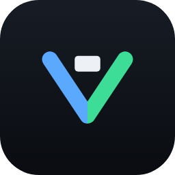

# Vutidy brand

Concept: a bold **V** for Vutidy, drawn with two strokes in the same round-capped style as its sibling app Vutty (two chevrons and a block cursor). The two arms are blue and mint and meet in a clean seam down the middle; the white rounded block sits in the mouth of the V like the one item you decided to keep. Flat, two colours plus white, no glow or decoration on the mark itself: it reads the same at 1024 px and at 16 px.

Tagline: **SAFE · CLEAN · UNDOABLE**: the three promises of the app (nothing risky is selected by default, it removes real clutter, and everything it removes can be restored).

| File | Use |
| --- | --- |
| `logo-mark.svg` / `logo-mark-1024.png` / `logo-mark-256.png` | App tile, avatars, social preview |
| `logo-horizontal.svg` / `.png` | Dark backgrounds (README dark mode, slides) |
| `logo-horizontal-light.svg` / `.png` | Light backgrounds (docs, white pages) |
| `favicon.svg` / `favicon-64.png` / `favicon-16.png` | Mark tuned for small sizes (thicker strokes, larger block) |
| `appicon.png` | macOS app icon source (1024 px with a 100 px safe margin) |
| `AppIcon.icns` | The icon bundled into `Vutidy.app` by `scripts/make-app.sh` |
| `render.mjs` | Renders the SVGs to PNG with Chromium (Playwright) |

Regenerate the PNGs with `PLAYWRIGHT=/path/to/node_modules/playwright/index.mjs node docs/assets/brand/render.mjs '<jobs json>'`; the job format is described at the top of the file. The `.icns` is built from `appicon.png` with `sips` and `iconutil` (see [Development](../../development/development.md#brand-and-icon)). The SVG wordmark uses a monospace font stack (JetBrains Mono, SF Mono, Menlo, Consolas, DejaVu Sans Mono) and Inter for the tagline; use the PNGs where the exact look matters.

The same shapes are drawn in SwiftUI by `LogoMark` in `Sources/Vutidy/Components.swift`; keep the two in sync if you change the geometry.

## Palette

| Token | Hex | Use |
| --- | --- | --- |
| Graphite top | `#171C25` | tile background (top of the subtle vertical gradient) |
| Graphite bottom | `#0A0C10` | tile background (bottom), text on light |
| Blue (`info`) | `#5AA9FF` | left arm of the V, "Vu" in the wordmark on dark |
| Mint (`signal`) | `#3DDC97` | right arm of the V, safe actions in the app |
| Mist | `#EDF0F4` | the block, text on dark |
| Blue on light | `#2F7BE0` | "Vu" in the wordmark on light backgrounds |
| Ink | `#0F1217` | "tidy" in the wordmark on light backgrounds |

The app palette (Graphite Glass) is documented in the [design spec](../../design/design-spec.md#2-design-tokens) and machine-readable in `docs/design/tokens/`.

## Rules

- Keep clear space of at least the width of the block around the mark.
- Minimum size: 24 px for the mark (use `favicon.svg` below 48 px).
- Do not swap the arm colours, add glow or gradients to the strokes, rotate, add outlines, or place the dark tile on a dark background without the lockup that fits.
- Do not use the name or logo of any other cleaner app. Vutidy only reproduces *features*, never another product's branding.
