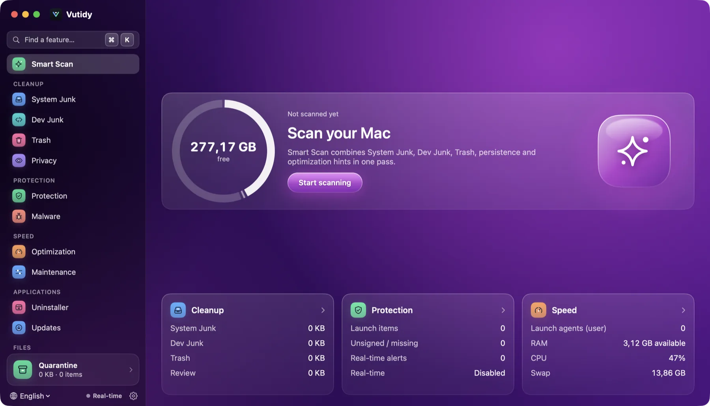
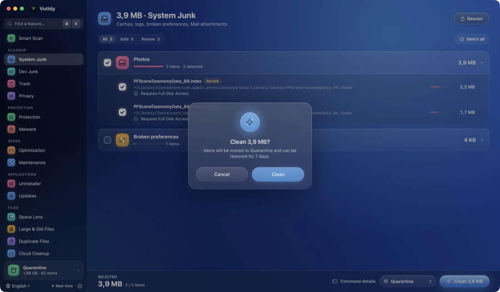

# Getting started

From install to your first safe clean in five steps.

## Contents

- [Your first scan in five steps](#your-first-scan-in-five-steps)
- [The main window](#the-main-window)
- [Full Disk Access](#full-disk-access)
- [What is selected by default](#what-is-selected-by-default)
- [Where to go next](#where-to-go-next)

## Your first scan in five steps

1. **Install.** Follow [Installing on macOS](../getting-started/install-macos.md) and open `dist/Vutidy.app`.
2. **Grant Full Disk Access** (optional but recommended, see [below](#full-disk-access)).
3. **Open Smart Scan** (⌘1) and press **Start scanning**. Nothing is changed by scanning.
4. **Read the result.** The big number is what Vutidy thinks it can give back. Open the cards (Cleanup, Protection, Speed) to see where it comes from.
5. **Preview, then clean.** Press **Preview (dry-run)** to see exactly what would happen. When you are happy, press **Clean** and choose *Move to Quarantine*. You can undo for 7 days (see [Quarantine and safety](08-quarantine-and-safety.md)).

**Step 3: press Start scanning.** Smart Scan is the first page in the sidebar. Press the purple button and wait; scanning only reads.

**Steps 4 and 5: read the result, then preview and clean.** The headline says how much you can get back. **Preview (dry-run)** shows what would happen without changing anything; **Clean** moves the Safe items to the Quarantine.

> **Tip.** Press **⌘K** at any time to search every feature by name, and hover a sidebar item to see its shortcut.

## The main window

*The main window on Smart Scan: sidebar on the left, the page on the right.*

What you see in the screenshot:

- **Sidebar.** A search field (**⌘K**) and every feature, grouped as Cleanup, Protection, Speed, Applications and Files. Each page has its own colour. Point at an item to see its keyboard shortcut. The **Quarantine** card at the bottom is always visible: it shows how much is waiting there and opens the list.
- **Bottom of the sidebar.** The **language** menu, the **Real-time** indicator (the monitor of new files, see [Protection](04-protection.md#real-time-monitor)), and the gear that opens [Settings](10-settings.md) (⌘,).
- **Page.** A header with the page name, then its content. The cleanup pages pin an **action bar** to the bottom of the window with the selected size and the Clean button.
- **Menu bar icon.** A small popover with the state of your Mac and recommendations; see [Menu bar](09-menu-bar.md).

## Full Disk Access

macOS protects some folders (Mail downloads, the Photos cache, the Safari cache, parts of iCloud Drive). Without **Full Disk Access** Vutidy skips them and a banner on Smart Scan, System Junk, Privacy and Cloud Cleanup says so. You can dismiss the banner with **×**.

To grant it, Vutidy has to run as a real app: build `dist/Vutidy.app` with `scripts/make-app.sh` and add it in *System Settings → Privacy & Security → Full Disk Access*. The step-by-step is in [Installing on macOS](../getting-started/install-macos.md#grant-full-disk-access). A bare `swift run Vutidy` has no bundle ID or icon and will not show up properly in that list.

## What is selected by default

Every item has a **safety level**:

| Level | Meaning | Selected by default |
| --- | --- | --- |
| **Safe** | Regenerated automatically (caches, logs, build products). | Yes |
| **Review** | Probably fine, but you should look: old IDE configuration, language models, an Xcode archive, large files. | No |
| **Dangerous** | Reserved for items that need an explicit, separate confirmation. | No |

Smart Scan's **Clean** button only ever touches *Safe* items. Anything marked *Review* has to be selected by you, by hand.

## Where to go next

- [Smart Scan](02-smart-scan.md) for the one-button scan.
- [Cleanup](03-cleanup.md) to understand the pages and the clean modes.
- [Quarantine and safety](08-quarantine-and-safety.md) before you clean anything you care about.
