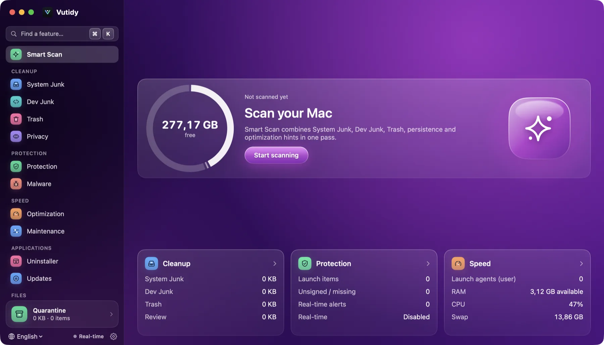
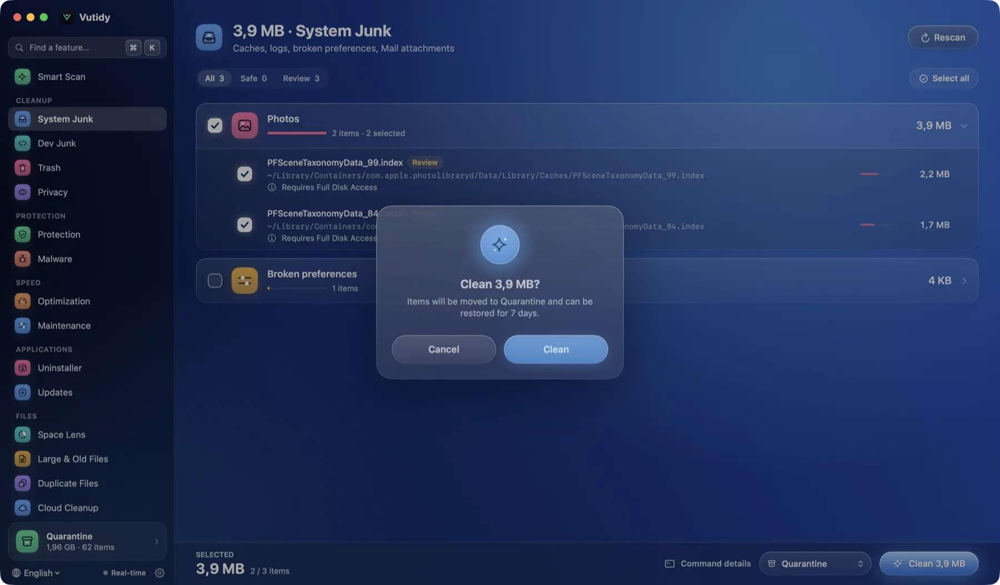

# Smart Scan

One scan that looks at everything at once. Open it from the sidebar or with **⌘1**.

## Contents

- [What it scans](#what-it-scans)
- [The result screen](#the-result-screen)
- [What each group means](#what-each-group-means)
- [Cleaning](#cleaning)
- [Limits](#limits)

## What it scans

*Before the first scan: the ring shows your free disk space and **Start scanning** begins the scan. The five groups below say *Not scanned yet* until it finishes.*

Smart Scan runs these in parallel:

| Part | Detail |
| --- | --- |
| System Junk | Caches, logs, crash reports, broken preferences, Mail downloads, the Photos cache ([Cleanup](03-cleanup.md#system-junk)) |
| Dev Junk | Docker, JetBrains, Node, Go, Xcode, Homebrew… and the project folders you chose ([Cleanup](03-cleanup.md#dev-junk)) |
| Trash | Your Trash and the Trash of external drives |
| Persistence | Launch agents and daemons with their code-signature state ([Protection](04-protection.md)) |
| Malware check | App signatures, launch items, shell profiles and the security settings of your Mac ([Protection](04-protection.md#malware-page)) |
| Speed | Launch items, apps that open at login and the processes using the most CPU ([Speed](05-speed.md)) |
| Applications | Homebrew updates and apps you have not opened for 90 days ([Applications](06-applications.md)) |
| Large files | Large files you have not opened for 90 days in Downloads ([Files](07-files.md#large--old-files)) |

The results are also handed to the individual pages, so opening *System Junk* afterwards shows the same items without scanning again.

## The result screen

*After a scan: the headline says how much space you can get back, **What will be cleaned** lists every group *Clean* will take, and **Your Mac's health** sums up five areas.*

- **Header.** When it was scanned and the headline: *Your Mac can get back X*.
- **Hero.** A ring of your disk (used, purgeable, free) with the current free space in the middle and, once there is something to clean, what it would be after cleaning. At the right: **Clean**, **Preview (dry-run)** and a reminder that it can be undone for 7 days.
- **What will be cleaned.** Open by default: every group of Safe items with its count and size (Docker, Cache, Logs…). Click a group to open its page. Click the title to fold the list.
- **Your Mac's health.** One row per area. A green tick means nothing needs you; an amber mark means something is worth a look. **Review** opens the right page. See [What each group means](#what-each-group-means).

Only the **Cleanup** group is acted on by *Clean*. The other four groups only report; they never change anything by themselves.

If nothing is found the hero says **Your Mac is tidy** and shows no Clean button.

## What each group means

| Group | Says | Review opens |
| --- | --- | --- |
| **Cleanup** | How much is Safe to clean and how much needs your review | [System Junk](03-cleanup.md#system-junk) |
| **Protection** | Findings of the malware check and launch items that are unsigned or missing a program | [Malware](04-protection.md#malware-page) (or Protection if the check did not run) |
| **Performance** | Available memory, apps that open at login, items whose file is gone, processes using a lot of CPU | [Optimization](05-speed.md) |
| **Applications** | Homebrew updates and apps not opened for 90 days (with their size) | [Updates](06-applications.md#updates), or the [Uninstaller](06-applications.md#uninstaller) when there are none |
| **Large & Old Files** | Large files in Downloads that you have not opened for 90 days | [Large & Old Files](07-files.md#large--old-files) |

The malware check and the extra groups add some time to the scan (usually under a minute). They only read; nothing is sent anywhere.

## Cleaning

**Clean** only takes the items marked **Safe**. It asks once:

- Safe files go to the **Quarantine** (restorable for 7 days by default).
- Items already in the Trash are deleted for good (they were already thrown away) and items cleaned through a tool's own command (`docker prune`, `go clean`, `brew cleanup`) cannot be restored. The confirmation says so.

**Preview (dry-run)** performs exactly the same steps without changing anything and shows the size it would free.

Afterwards a toast shows how much was moved, with an **Undo** link that opens the Quarantine.

## Limits

- The sizes are *allocated* sizes. APFS clones and purgeable space make the real gain differ a little, so the numbers are estimates.
- Smart Scan does not run the heavier modules (Duplicates, Space Lens, Cloud Cleanup) and looks only in Downloads for large files. Open those pages when you want them.
- It does not run on a schedule yet.
