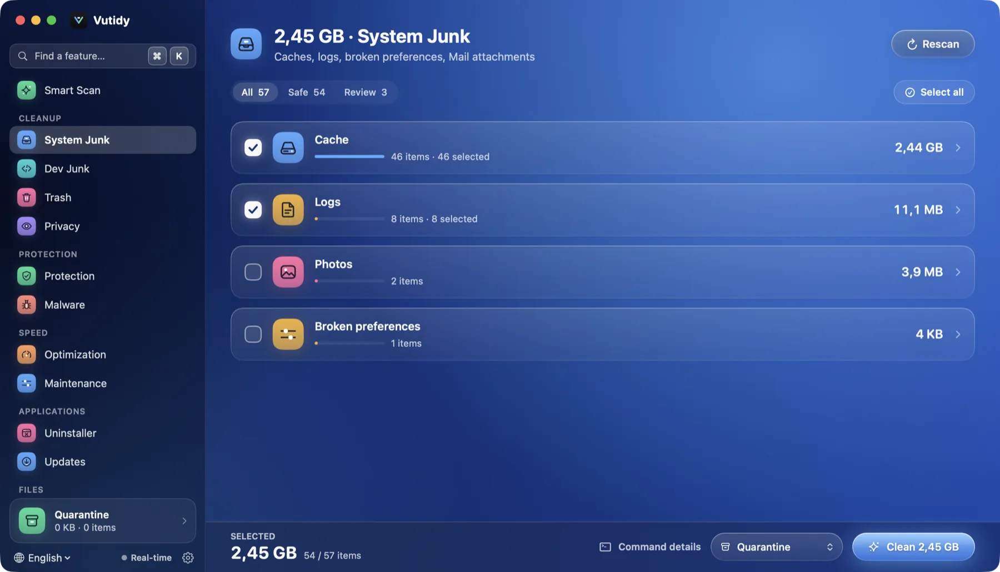
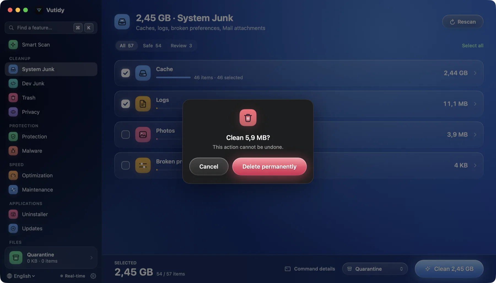
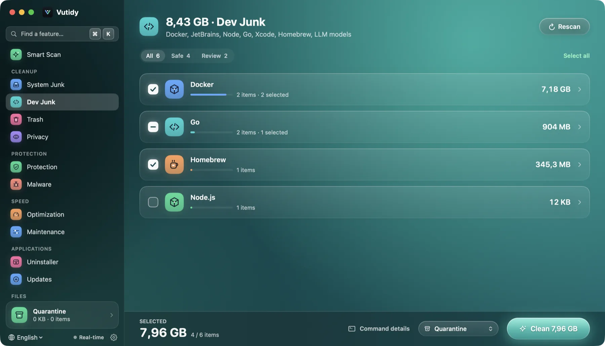
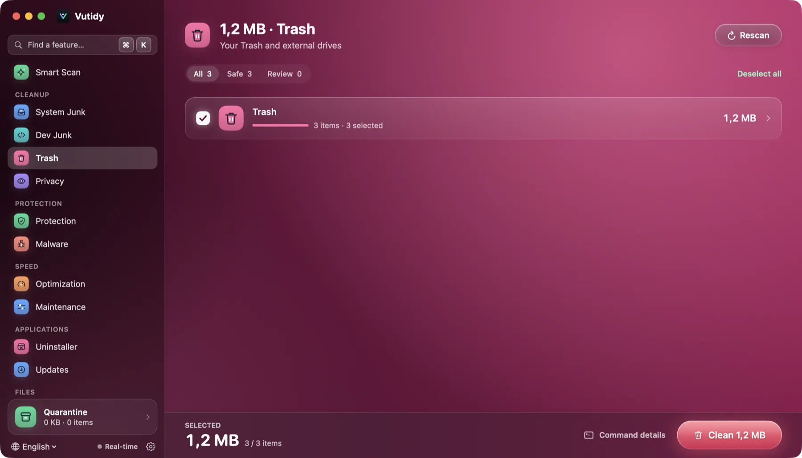
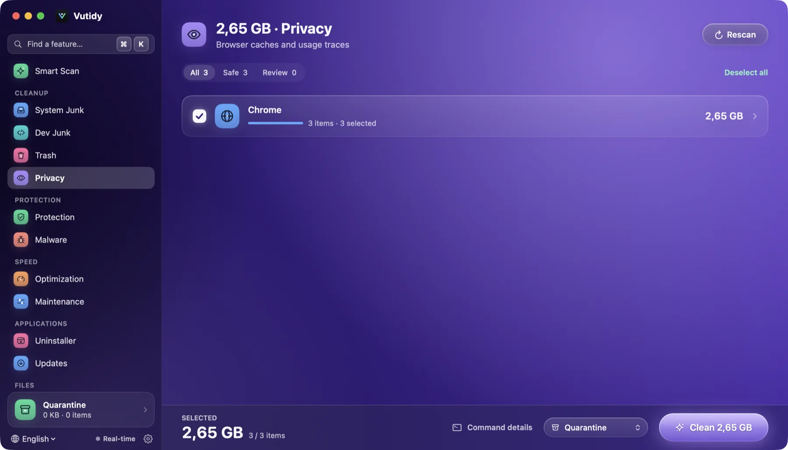

# Cleanup

Four pages find clutter and move it out of the way: **System Junk** (⌘2), **Dev Junk** (⌘3), **Trash** (⌘4) and **Privacy** (⌘5). They share one layout and one set of rules.

## Contents

- [How a cleanup page works](#how-a-cleanup-page-works)
- [Safety levels](#safety-levels)
- [Clean modes](#clean-modes)
- [The action bar](#the-action-bar)
- [System Junk](#system-junk)
- [Dev Junk](#dev-junk)
- [Trash](#trash)
- [Privacy](#privacy)
- [Your own rules](#your-own-rules)
- [Limits](#limits)

## How a cleanup page works

*A cleanup page after scanning (System Junk). Category cards in the middle, filter chips on top, the action bar pinned to the bottom.*

1. **Scan.** The page opens with a large icon and a **Scan** button (it scans by itself the first time you open it). Nothing is changed.
2. **Category cards.** Results are grouped into cards, one per source (for example *Docker*, *JetBrains*, *Cache*, *Log*). A card shows a coloured icon, the name, how many items it holds, a bar for its share of the total and its size. The circle at the left selects or unselects the whole card; click the card to open it and see each item with its path (or the command that would run).
3. **Filter.** The chips *All / Safe / Review* (with counts) filter the list. *Select all* / *Deselect all* is at the right.
4. **Clean.** The [action bar](#the-action-bar) at the bottom of the window shows what is selected.

Right-click an item and choose **Reveal in Finder** to look at it first.

## Safety levels

| Level | What it means | Default |
| --- | --- | --- |
| **Safe** | Rebuilt by the system or tool when needed. | Selected |
| **Review** | Probably fine but could cost you something: a model you downloaded, an Xcode archive with debug symbols, the config of an older IDE version. Marked with an amber *Review* badge. | Not selected |
| **Dangerous** | Shown, never selected, needs its own confirmation. No built-in rule uses it yet. | Not selected |

The badge always has a word, not only a colour.

## Clean modes

The mode menu in the action bar sets what *Clean* does:

| Mode | What happens | Undo |
| --- | --- | --- |
| **Quarantine** (default) | Items are moved to Vutidy's Quarantine, keeping permissions and extended attributes. | Restore for 7 days (configurable) |
| **Trash** | Items go to the Finder Trash. | Put Back in Finder |
| **Preview only** | Nothing changes; you see what would happen and the size. | n/a |
| **Delete permanently** | Used automatically on the *Trash* page only, because those items are already thrown away. | No |

Items cleaned with a tool's own command (shown with a **CLI** tag and a `$ command` line, for example `docker image prune -f`) are run in every mode except *Preview only* and **cannot be restored**.

The **default mode** is set in [Settings → General](10-settings.md#general), and **Confirm before cleaning** there turns the confirmation dialog off.

## The action bar

*The confirmation dialog. In *Quarantine* mode it simply says how much will be moved; for permanent deletion (the Trash page) it warns that the action cannot be undone.*

Pinned to the bottom of the window:

- **Selected**: the size and *n / total items*.
- **Command details**: opens the **Commands to run** list (the first six, with `$ mv ~/path → Quarantine`, `$ trash …`, `$ rm -rf …` or `$ docker …`), so you can see exactly what will happen.
- **Mode** menu.
- **Clean X** (⌘↩). After the confirmation a toast reports the result, with *Undo* when the mode was Quarantine. Items that could not be removed or were skipped by the safety layer are counted (*n errors · n skipped*).

## System Junk

| Source | Safety | Notes |
| --- | --- | --- |
| User caches (`~/Library/Caches/*`) | Safe | Skips Apple's own, CloudKit, tool caches handled elsewhere, and any app that is running right now |
| User logs (`~/Library/Logs/*`) | Safe | |
| Crash reports | Safe | Only older than 7 days |
| Mail downloads | Review | Needs Full Disk Access |
| Photos cache | Review | Needs Full Disk Access |
| Broken preferences | Review | Preference `.plist` files that cannot be parsed or are empty |

Language files (`*.lproj`) are deliberately **not** offered: removing them breaks an app's code signature.

## Dev Junk

*Dev Junk groups what developer tools leave behind. Open a card to see each path or the command that would run.*

The module that sets Vutidy apart.

| Group | What is found | Safety | How it is cleaned |
| --- | --- | --- | --- |
| **Docker** | Unused images, build cache (safe); stopped containers, unused volumes (review) | mixed | `docker image / builder / container / volume prune -f` (**CLI**, no undo) |
| **JetBrains** | IDE caches and logs (skipped while an IDE runs); config of older IDE versions | Safe / Review | files; the newest version of each IDE is always kept |
| **Node.js** | npm, Yarn caches; pnpm store (review) | Safe / Review | files |
| **Go** | build cache; module cache (review) | Safe / Review | `go clean -cache` / `-modcache` (**CLI**) |
| **PHP, Python, CocoaPods** | Composer, pip, CocoaPods caches | Safe | files |
| **Xcode** | DerivedData, CoreSimulator caches (safe); Archives, iOS DeviceSupport (review) | mixed | files |
| **Homebrew** | the download cache | Safe | `brew cleanup -s --prune=all` (**CLI**) |
| **JVM / Rust** | Gradle caches, Cargo registry cache | Review | files |
| **LLM** | Ollama models, Hugging Face hub | Review | files; listed only, never preselected |
| **Projects** | `node_modules`, `vendor`, `target`, `.venv`/`venv`, `Pods` of projects whose manifest has not changed in *N* days | Review | files |

A rule whose tool is not installed (no `go`, no `brew`, no `docker`) simply does not appear.

**Project folders.** Vutidy never walks your whole home folder. To find old `node_modules` and friends, add the folders where your projects live in [Settings → Cleaning](10-settings.md#cleaning). A project counts as old when its `package.json` (or `composer.json`, `Cargo.toml`, `pyproject.toml`, `requirements.txt`, `Podfile`) has not changed for the number of days set there (60 by default).

Docker's disk image (`Docker.raw`) is never deleted directly; Space Lens warns about it and sends you here.

## Trash

*The Trash page.*

Your Trash and the Trash of each external drive. This is the one page where *Clean* deletes for good, because the items were already thrown away. The confirmation says so.

## Privacy

*The Privacy page lists browser caches only. History, cookies and passwords are never touched.*

Browser caches: Chrome, Firefox, Arc, Safari (Safari needs Full Disk Access) and the Quick Look thumbnail cache. Close the browser first for the best result. Vutidy does not delete history, cookies or passwords.

## Your own rules

Rules are data, not code. Bundled rules are in `Sources/RuleEngine/Resources/rules.json`. To add or override one without rebuilding, put a JSON array of rules in a `.json` file inside `~/Library/Application Support/Vutidy/Rules/` (**Settings → Storage → Open rules folder**). A rule with the same `id` replaces the bundled one. The fields are described in the [development guide](../development/development.md#add-a-cleaning-rule).

## Limits

- Sizes are allocated sizes and are estimates (see [Smart Scan](02-smart-scan.md#limits)).
- The blocklist (see [Quarantine and safety](08-quarantine-and-safety.md#the-blocklist)) always wins: a rule cannot make Vutidy touch `~/Documents`, `~/Desktop`, keychains, `.ssh` and so on.
- Items inside system locations that need administrator rights are listed but may be skipped; there is no privileged helper yet.
