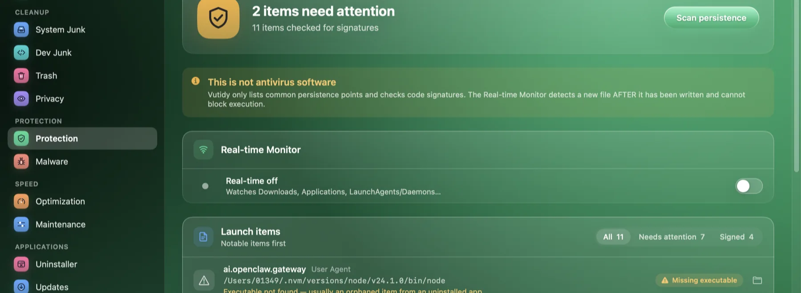
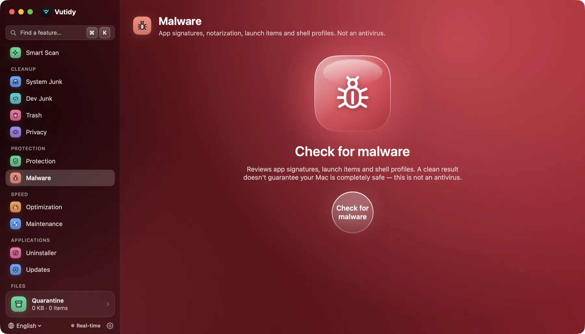

# Protection

**Protection** (⌘6) answers two questions: *what starts by itself on this Mac?* and *did something new just appear in a sensitive place?* It is **not an antivirus**.

## Contents

- [What this is, and what it is not](#what-this-is-and-what-it-is-not)
- [Persistence scanner](#persistence-scanner)
- [Real-time monitor](#real-time-monitor)
- [Malware page](#malware-page)
- [Limits](#limits)

## What this is, and what it is not

Vutidy does not have a malware signature database and cannot stop a program from running. It lists the places malware commonly uses to survive a restart and checks whether the programs there are properly signed. That finds *unfamiliar* things; it does not prove anything is malicious or safe. The page says so in a note at the top.

## Persistence scanner

*Protection: the scan summary, the "not antivirus" note and the Real-time Monitor switch. Launch items are listed below.*

Press **Scan persistence**. Vutidy reads these folders:

- `~/Library/LaunchAgents`
- `/Library/LaunchAgents`
- `/Library/LaunchDaemons`

For each `.plist` it finds the program it runs and checks its code signature:

| Trust | Meaning |
| --- | --- |
| **Apple** | Signed by Apple |
| **Signed** | Validly signed by a developer (has a Team ID) |
| **Unsigned / ad-hoc** | No valid developer signature |
| **Program missing** | The plist points to a file that no longer exists |
| **Unknown** | The signature could not be read |

Unsigned and missing items are listed first and counted in the header (*n items need attention*). The header says *All launch items are valid* when there are none. Each row shows the app icon and name when the program is inside an app bundle, the program path and a trust pill.

Items here are for information. Turn a launch item on or off in [Speed → Startup items](05-speed.md#startup-items).

## Real-time monitor

Switch it on with the **Real-time** indicator at the bottom of the sidebar, in this page, in the menu bar popover, or with **⌘⇧R**. You can also start it at launch in [Settings → General](10-settings.md#general).

It watches these folders with macOS FSEvents:

`~/Downloads`, `~/Desktop`, `/Applications`, `~/Applications`, `~/Library/LaunchAgents`, `/Library/LaunchAgents`, `/Library/LaunchDaemons`, `/Library/PrivilegedHelperTools`.

When a file appears or changes, Vutidy waits two seconds for it to finish writing, then:

- A new `.plist` in a **LaunchAgents/LaunchDaemons** folder **always** raises an alert, even when it is clean, because that is the most common persistence trick.
- A new app, disk image, installer package, script, dynamic library or Mach-O program is checked: alerts are raised for unsigned items and for every `.dmg`, `.pkg`, `.sh` and `.command`. The alert mentions when the file came from the Internet (it carries the `com.apple.quarantine` attribute).
- Files larger than 500 MB, hidden files and half-downloaded files are ignored.

Alerts appear in this page (the latest 20) and the *Last scanned* line shows the last file looked at. The monitor runs at low priority.

## Malware page

The **Malware** page in the sidebar runs a deeper check of app signatures, notarization, launch items and shell profiles. It carries the same warning: a clean result does not guarantee your Mac is safe.

*The Malware page before the first check.*

## Limits

- **Detection comes after the fact.** FSEvents tells Vutidy a file was written; it cannot block the file from being opened. Blocking would need Apple's Endpoint Security entitlement, which is planned for a later version.
- No signature scanning (YARA) yet.
- Persistence checks cover launch agents and daemons only. Login items, cron, configuration profiles and browser extensions are not inspected yet.
- A valid signature does not mean a program is harmless, and an unsigned one is not necessarily bad (many developer tools are unsigned).
