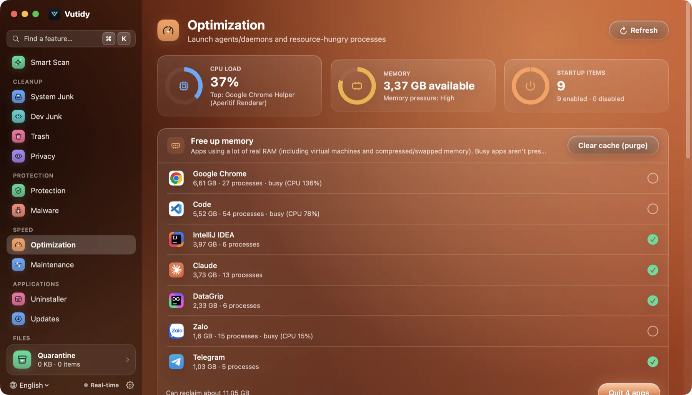
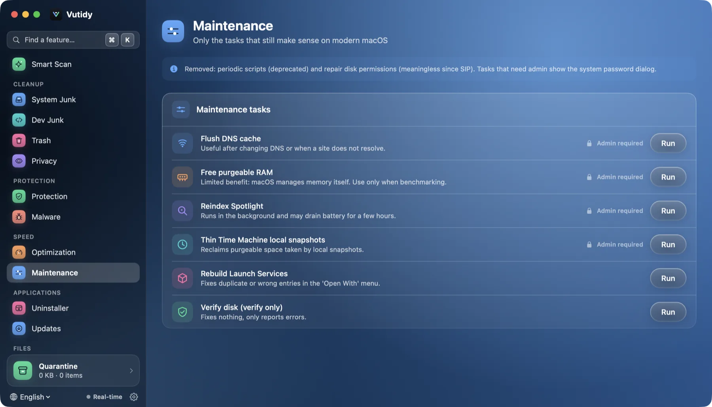

# Speed

Two pages: **Optimization** (⌘7) shows what is using your Mac and what starts with it, and **Maintenance** (⌘8) runs a few system tasks that are still useful.

## Contents

- [Optimization](#optimization)
- [Startup items](#startup-items)
- [Maintenance](#maintenance)
- [Limits](#limits)

## Optimization

*Optimization: three gauges on top, then the apps using the most memory, which you can quit in one click.*

At the top, three gauges refresh every few seconds:

| Gauge | Shows |
| --- | --- |
| **CPU load** | Current load and the busiest process |
| **Memory** | Available memory and the *memory pressure* (Normal, High, Critical) |
| **Startup items** | How many launch items are on, and how many are off |

**CPU-hungry processes** lists the busiest processes with their app icon, memory, CPU % and a bar. The top six are shown; **Show all** expands the list. For a regular app (not Finder, not Vutidy itself) a **Quit app** button asks it to quit politely. Helper processes and system services have no button.

## Startup items

The **Startup items** card lists the launch agents and daemons found in `~/Library/LaunchAgents`, `/Library/LaunchAgents` and `/Library/LaunchDaemons`, with the app icon and name when the program lives in an app bundle. Use the chips *All / Running / Disabled / System* to filter.

Each row has a **switch**:

- Turning a *user* agent off unloads it (`launchctl bootout`) and disables it (`launchctl disable`). **No file is deleted**, so you can turn it back on.
- Items in `/Library` (marked with a lock) need administrator rights: macOS shows its own password dialog.
- A *Running* pill shows what is loaded right now.

## Maintenance

*Maintenance: each task shows whether it needs administrator rights.*

Only tasks that still make sense on a modern Mac:

| Task | What it does | Admin |
| --- | --- | --- |
| Flush DNS cache | `dscacheutil -flushcache; killall -HUP mDNSResponder` | Yes |
| Free purgeable RAM | `purge`; the benefit is limited, macOS manages memory itself | Yes |
| Reindex Spotlight | `mdutil -E /`; runs in the background and may use battery for hours | Yes |
| Thin Time Machine local snapshots | `tmutil thinlocalsnapshots`; frees *purgeable* space | Yes |
| Rebuild Launch Services | `lsregister -kill -r …`; fixes a duplicated or wrong *Open With* menu | No |
| Verify disk | `diskutil verifyVolume /`; only verifies, repairs nothing | No |

Point at a task to see its exact command. The output of a run appears under the task. When a task needs administrator rights, Vutidy shows the standard macOS password prompt; it never stores the password.

**Removed on purpose:** the `periodic` scripts (deprecated) and *repair disk permissions* (meaningless since System Integrity Protection).

## Limits

- There is no privileged helper yet; administrator tasks use the macOS prompt (`osascript … with administrator privileges`).
- CPU temperature and fan speed are not shown; they need private APIs.
- Login Items added through System Settings (the modern list) are not listed, only launch agents and daemons.
