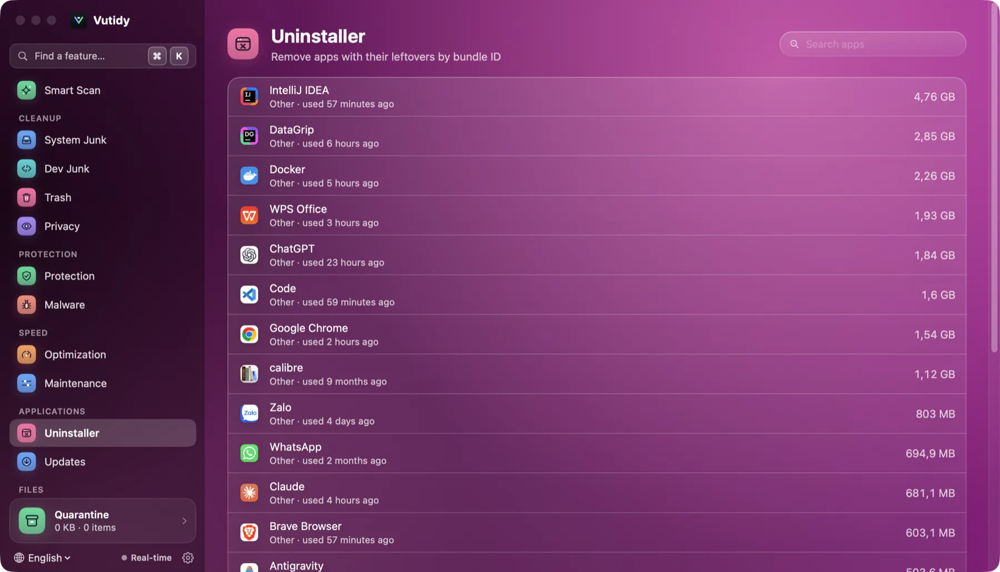
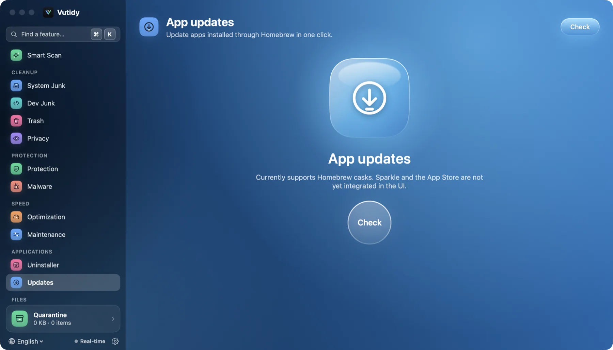

# Applications

**Uninstaller** (⌘9) and **Updates** (⌘⇧U).

## Contents

- [Uninstaller](#uninstaller)
- [Updates](#updates)
- [Limits](#limits)

## Uninstaller

*The Uninstaller lists apps largest first, with where each came from and when you last used it.*

Lists the apps in `/Applications` and `~/Applications` (Apple's own apps are left out), largest first, with each app's icon, where it came from (**App Store**, **Homebrew** or **Other**), when you last used it and its size. Use the search box to find one.

Click an app to see what removing it would involve:

- The **app itself**.
- **Leftovers** found in the folders apps write to: `~/Library/Application Support`, `Caches`, `Preferences`, `Containers`, `Group Containers`, `Saved Application State`, `HTTPStorages`, `WebKit`, `Logs`, `LaunchAgents`, `Cookies`, and in `/Library`: `Application Support`, `LaunchAgents`, `LaunchDaemons`, `PrivilegedHelperTools`, `Preferences`, `Caches`.

How a leftover is matched, and so how safe it is:

| Match | Safety |
| --- | --- |
| The file name contains the app's **bundle ID** | Safe |
| The file name is exactly the app's name, inside *Application Support* | Review (not selected) |

Untick anything you want to keep, then press **Uninstall**. This is a **real uninstall, not a move to Quarantine**: Vutidy quits the app (force-quits it if needed), unloads its launch agents, then **permanently deletes** the app and every selected leftover. The confirmation says so and shows how many items and how much space are involved. Every deletion goes through the same safety blocklist and is written to the audit log. Items in `/Library` that need administrator rights are retried through the macOS password dialog.

## Updates

*Updates before the first check. Press **Check** to ask Homebrew what is outdated.*

Press **Check**. Vutidy asks Homebrew (`brew outdated --cask --greedy`) which casks have a newer version and lists them with *installed → latest*. Each row has an **Update** button that runs `brew upgrade --cask <name>` for that app, with a spinner while it works and the last error line shown if it fails. **Update all** (with a confirmation) does it for every row. Open apps may be closed and some casks ask for an administrator password, which a non-interactive run cannot give: such an update fails with a message instead of hanging. Every update is written to the audit log.

## Limits

- Items in `/Library` need administrator rights, which the uninstall does not ask for yet, so they may be skipped (they are marked *Admin rights required*).
- Sparkle appcasts and the App Store are not checked yet; Updates covers Homebrew casks only.
- Leftover detection is by name. An app with an unusual naming scheme may leave something behind, and the *Review* items deserve a look before you select them.
