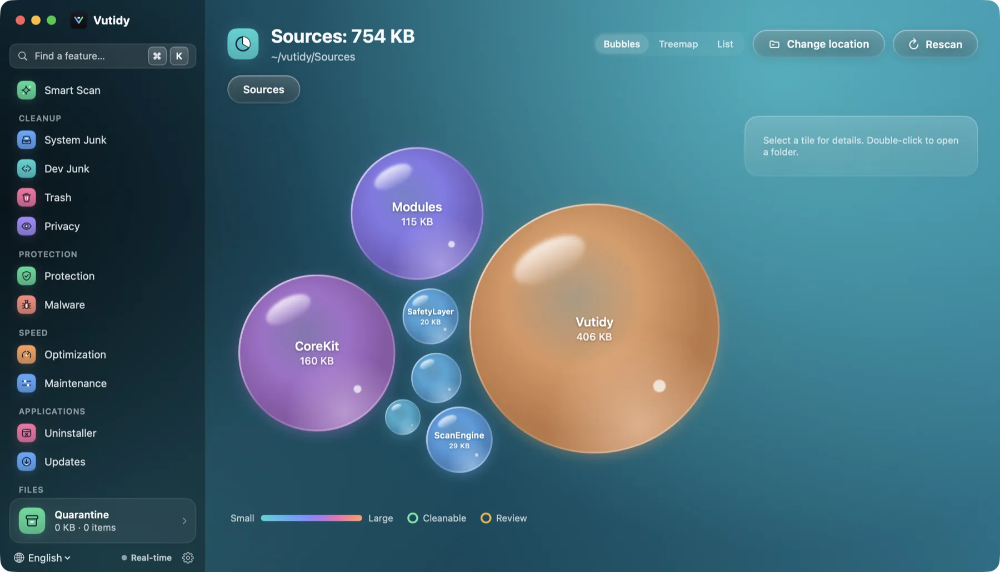
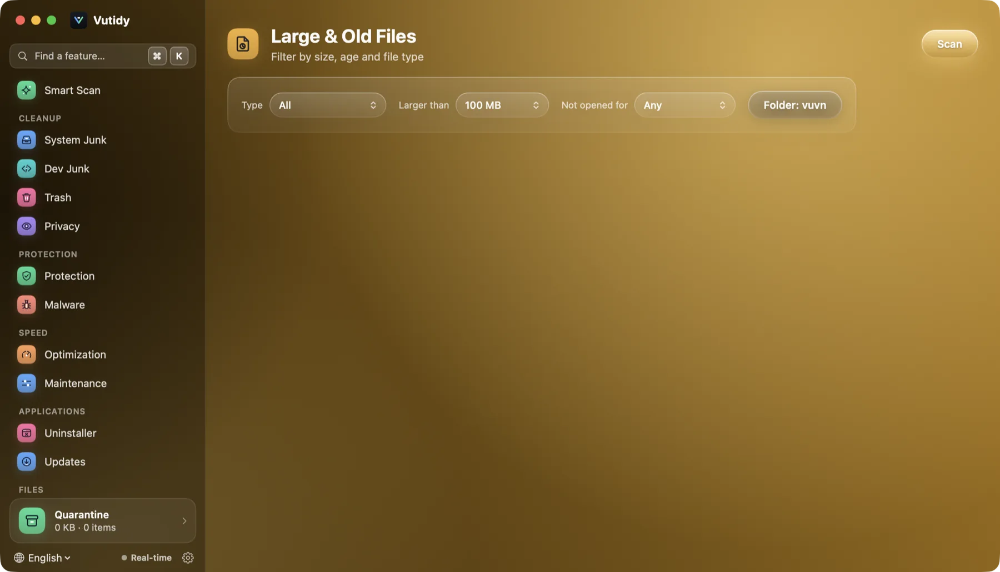
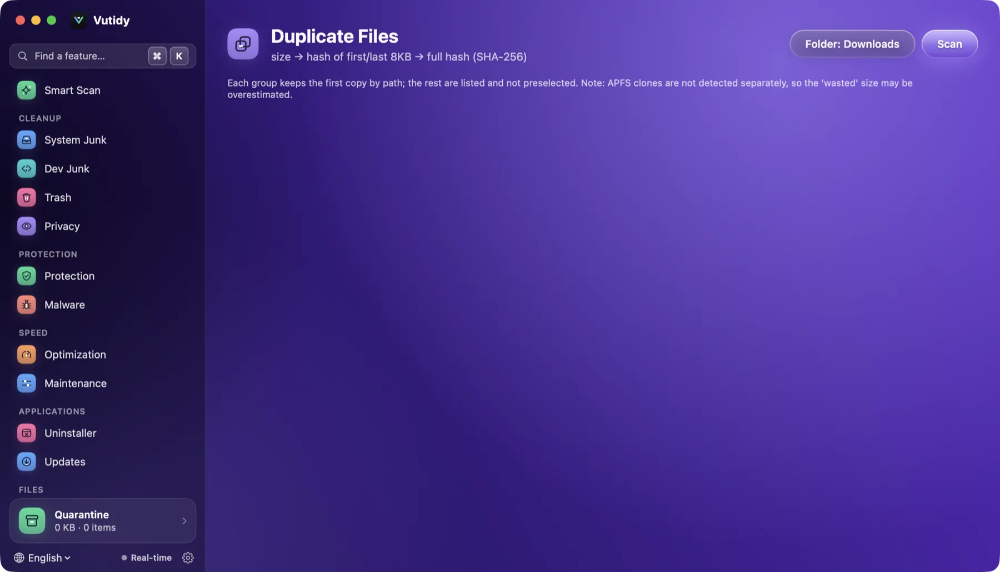
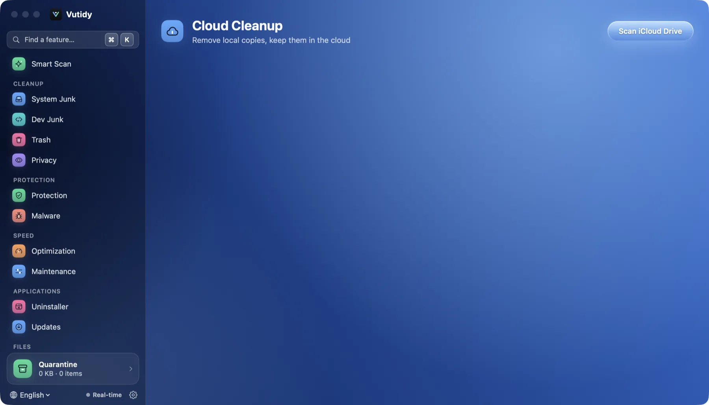

# Files

Four pages for finding space by *where it is* rather than *what it is*: **Space Lens** (⌘⇧L), **Large & Old Files** (⌘⇧F), **Duplicates** (⌘⇧D) and **Cloud Cleanup** (⌘⇧C). What Space Lens, Large & Old Files and Duplicates remove goes to the **Quarantine**; Cloud Cleanup only drops the local copy of an iCloud file.

## Contents

- [Space Lens](#space-lens)
- [Large & Old Files](#large--old-files)
- [Duplicates](#duplicates)
- [Cloud Cleanup](#cloud-cleanup)
- [Limits](#limits)

## Space Lens

*Space Lens in Bubbles view. The bubble's area is the folder's size; the colour scale is at the bottom.*

A picture of where your disk space went. Nothing is scanned when you open the page: you **choose where to scan first**.

- **Where to scan.** Pick the whole disk (shown by its real name, for example *Macintosh HD*, with `/` as the root), your Home folder, Downloads, Documents, Desktop, Applications, Library, any external volume, or **Choose folder…**. Scanning the whole disk takes longer; the page says so. Paths are shown the way you know them (`/Users/...`), never with the internal `/System/Volumes/Data` prefix.
- **Live progress and Cancel.** While it scans you see the number of files and the size found so far and the folder being read, and you can cancel at any time. The first two folder levels are read in parallel to keep it quick.
- **Bubbles** (default). One bubble per folder or file; its **area is its size**, so the biggest things are the biggest bubbles. Bubbles never overlap and the group is scaled to fill the chart. The **colour shows how much space it takes** (teal for small, through blue, purple and pink, to orange for the largest) and a **ring shows its status**: green for things that are normally safe to clean (caches, `node_modules`, DerivedData, logs) and amber for things worth a look (Downloads, Docker, model folders). **Hover** a bubble to enlarge and light it up with its name and size while the others fade, so you can focus on it. **Treemap** and **List** are available as alternatives.
- **Click** a bubble to select it and see its path, size and status at the right; **double-click** a folder to open it. Folders already scanned open instantly from memory; only an unscanned folder is read again. The breadcrumb takes you back up, **Change location** returns to the picker and **Rescan** reads the same place again.
- The panel at the right offers **Open**, **Reveal in Finder** and **Move to Quarantine** (with a confirmation).
- Each folder shows its biggest 36 bubbles and groups the rest in one grey "n more items" bubble.
- Docker's disk image is flagged with a warning and a shortcut to Dev Junk instead of an invitation to delete it.

Without Full Disk Access some protected folders cannot be read, so their size is under-counted.

## Large & Old Files

*Set the filters, then press **Scan**.*

Set the filters, choose the folder (your home by default) and press **Scan**:

- **Type**: all, archives, video, disk images, installers.
- **Larger than**: 50 MB, 100 MB, 500 MB or 1 GB.
- **Not opened for**: any, 30 days, 90 days, 1 year (uses Spotlight's *last used* date, falling back to the access/modified time).

Nothing is selected for you. Tick the files to remove and press **Move to Quarantine**. Folders such as `Library`, `.Trash`, `.git` and `node_modules` are skipped, and bundles (apps, photo libraries) are treated as one file.

## Duplicates

*Duplicates before a scan.*

Press **Scan** after choosing a folder (Downloads by default). Vutidy narrows candidates in three steps so it reads as little as possible:

1. files of exactly the same **size** (ignoring files under 1 KB);
2. a **partial hash** (SHA-256 of the first and last 4 KB);
3. a **full hash** (SHA-256 of the whole file) for those that still match.

Each group keeps its **first copy by path** (shown as *Original*) and lists the other copies, **none selected**. The header shows the space the extra copies waste. Hard links to the same file are not counted as duplicates.

## Cloud Cleanup

*Cloud Cleanup lists iCloud Drive files that are downloaded to this Mac.*

Lists the large files in **iCloud Drive** that are downloaded to this Mac and can be evicted. **Remove local copy** removes only the copy on your Mac; the file stays in iCloud and downloads again when opened. It needs Full Disk Access to see inside iCloud Drive.

## Limits

- Duplicates cannot tell an **APFS clone** (which uses no extra space) from a real copy, so the *wasted* size can be overestimated.
- Space Lens shows one drive at a time and does not follow mount points into other volumes.
- Google Drive, OneDrive and Dropbox (File Provider) eviction is not implemented; only iCloud Drive is.
