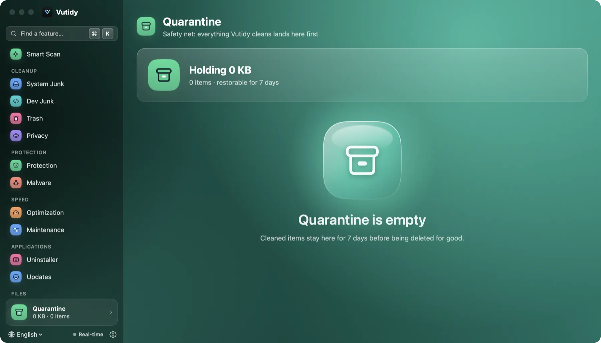

# Quarantine and safety

Vutidy deletes files, so safety is the first design rule. This chapter lists every protection and its limits.

## Contents

- [The principles](#the-principles)
- [The blocklist](#the-blocklist)
- [Quarantine](#quarantine)
- [Undo](#undo)
- [The audit log](#the-audit-log)
- [Running apps](#running-apps)
- [Administrator rights](#administrator-rights)
- [What is not covered](#what-is-not-covered)

## The principles

1. **Scanning never changes anything.** Only an explicit *Clean* does.
2. **Nothing risky is preselected.** Only *Safe* items start selected.
3. **Show before doing.** *Preview only* mode, and the *Commands to run* list, show exactly what will happen.
4. **Move, don't delete.** The default mode moves items to the Quarantine; Trash mode uses the Finder Trash.
5. **One way in.** Every removal goes through one component (`ActionExecutor`) that applies the blocklist, the mode and the audit log. No page deletes files on its own.

## The blocklist

A hard list of paths Vutidy refuses to remove, whatever a rule or you select. Items on it are skipped and reported as *blocked*.

| Where | Protected |
| --- | --- |
| System | `/System`, `/bin`, `/sbin`, `/usr` (but not `/usr/local`), `/etc`, `/private/etc`, `/dev`, `/cores`, `/private/var/db`, `/Library/Keychains`, `/Library/Apple`, `/Library/Extensions` |
| Your home | `~/Documents`, `~/Desktop`, `~/.ssh`, `~/.gnupg`, `~/Library/Keychains`, `~/Library/Mobile Documents` (iCloud), Address Book, Messages, Safari bookmarks, the originals and database of the Photos library |
| Containers of these | `/`, your home folder itself, `~/Library` itself and any folder that *contains* a protected path (for example `~/Pictures`) |

Paths are normalized first, so `..` tricks and **symbolic links that point into a protected area** are caught. Relative paths are refused.

Because `~/Documents` and `~/Desktop` are protected, Vutidy will not delete a `node_modules` or a large file inside them; move such projects elsewhere or remove the folder yourself.

## Quarantine

*The Quarantine page. The card at the bottom of the sidebar shows how much is waiting there. Here it is empty.*

The default destination of a clean. Each item is moved (not copied) to `~/Library/Application Support/Vutidy/Quarantine/<id>/` with its permissions and extended attributes intact, and recorded with its original path, size, the rule that selected it and the time.

- **Retention**: 7 days by default, 1 to 60 in [Settings → Cleaning](10-settings.md#cleaning). Expired items are deleted when Vutidy starts and when you open the Quarantine page.
- The **Quarantine card** at the bottom of the sidebar always shows the size and count; click it to open the list (⌘⇧Y).
- Each row shows the original path, size, a small ring with the **days left**, **Restore** and a trash button to delete that item for good now. **Settings → Storage → Empty Quarantine** deletes everything.

## Undo

- **Restore** moves the item back to its **exact original path**, creating missing parent folders.
- If something already exists at that path, the restore is **refused** instead of overwriting it; move or rename the new file first.
- A toast after a clean has an **Undo** link that opens the Quarantine.
- Items cleaned through a tool's command (`docker prune`, `go clean`, `brew cleanup`) and items deleted from the Trash page are **not** restorable. They carry a *CLI* tag or a confirmation that says so.

## The audit log

Every removal or command is appended to `~/Library/Application Support/Vutidy/audit.log` as one JSON line: time, action (`remove` or `command`), path or command, size, rule ID, mode and result (`done`, `dryRun`, `skipped: …`, `failed: …`). Dry runs are logged too. Read it with `vutidy-cli audit` or **Settings → Storage → Show in Finder**. Vutidy never deletes or uploads it.

## Running apps

Caches of an app that is **running** are skipped, and all JetBrains and Xcode rules are skipped while the IDE is open, so you never pull data from under a live program.

## Administrator rights

There is no privileged helper yet. Maintenance tasks and `/Library` launch items use the standard macOS password dialog. Files that need root to remove are not removed silently: they are skipped and reported.

## What is not covered

- It cannot protect you from **choosing** to delete something important in a *Review* item or in Large & Old Files. Read before you clean.
- *Delete permanently* and CLI cleanups cannot be undone.
- The Quarantine lives on the same disk, so it does not free space until it expires or is emptied.
- Vutidy is not a backup tool; keep Time Machine on.
