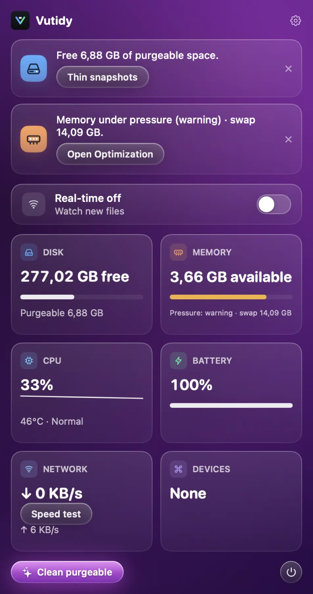

# Menu bar

The **sparkles icon** in the menu bar opens a popover with the state of your Mac and a few quick actions. It keeps running when the main window is closed.

## Contents

- [Recommendations](#recommendations)
- [Real-time monitor](#real-time-monitor)
- [Tiles](#tiles)
- [Speed test](#speed-test)
- [Limits](#limits)

## Recommendations

*The menu bar popover: recommendations on top, the Real-time switch, then the system tiles.*

A row of cards at the top, each with an icon, a sentence and one button. Use the **‹ ›** buttons (or the dots below) to move between cards: a mouse cannot drag the row sideways, so the buttons do it. The **×** on a card hides it.

| Card | Appears when | Button |
| --- | --- | --- |
| Free purgeable space | more than 5 GB purgeable | Thin snapshots (opens Maintenance) |
| Disk is low | under 10 % free | Open Space Lens |
| No persistence scan | none for 7 days | Scan now |
| Dev Junk to clean | more than 5 GB safe (from the last scan) | Open Dev Junk |
| Updates | one or more Homebrew casks outdated | Open Updates |
| Unused apps | apps not opened for 90 days | Open Uninstaller |
| Many startup items | more than 15 | Open Optimization |
| Battery health | below 80 % | Open Optimization |

Up to five cards show, highest priority first. A hidden card stays hidden for **7 days**, and comes back sooner only if the problem has become 50 % worse. Cards use the data already measured; they never start a heavy scan.

## Real-time monitor

A switch for the [real-time monitor](04-protection.md#real-time-monitor).

## Tiles

| Tile | Shows |
| --- | --- |
| **Disk** | Free space and purgeable space |
| **Memory** | Available memory, memory pressure and swap |
| **CPU** | Load now and a sparkline of the last minutes |
| **Battery** | Percentage, charging, health and cycle count (if your Mac has a battery) |
| **Network** | Download and upload speed right now |
| **Devices** | Bluetooth devices that report a battery level; below 20 % is highlighted |

The numbers refresh every three seconds.

## Speed test

**Speed test** in the Network tile runs macOS's own `networkQuality` and shows download and upload in Mbps. The last 20 results are kept in `~/Library/Application Support/Vutidy/speedtest.json`. It never runs by itself, because it uses bandwidth.

**Open Vutidy** brings the main window forward (and reopens it if you closed it). **Quit** exits the app completely, menu bar icon included.

## Closing the window keeps Vutidy running

Vutidy is meant to keep watching your Mac from the menu bar, so **closing the window or pressing ⌘Q only hides the app to the menu bar**: the Dock icon goes away, the process keeps running, and the disk, memory, CPU and battery readings, the real-time monitor and the recommendations stay live. Click the menu bar icon and choose **Open Vutidy** to bring the window back. To really quit use **Quit** in the popover or **Vutidy → Quit Vutidy Completely** (⌥⌘Q). Logging out, restarting or shutting down are never blocked.

## Limits

- CPU temperature, fan speed and iPhone battery are not shown; they need private APIs.
- Bluetooth battery comes from `system_profiler`, so it can be slow to appear and some devices do not report a level.
- Notifications (low disk, high temperature) are not implemented.
