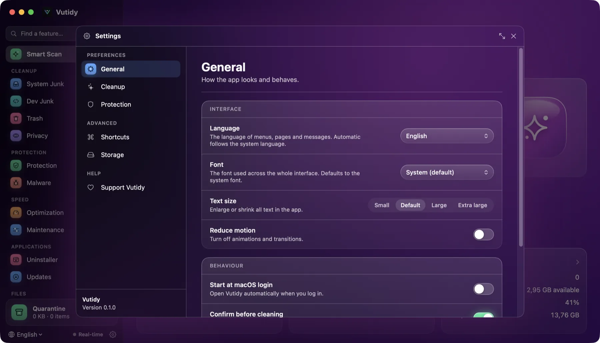
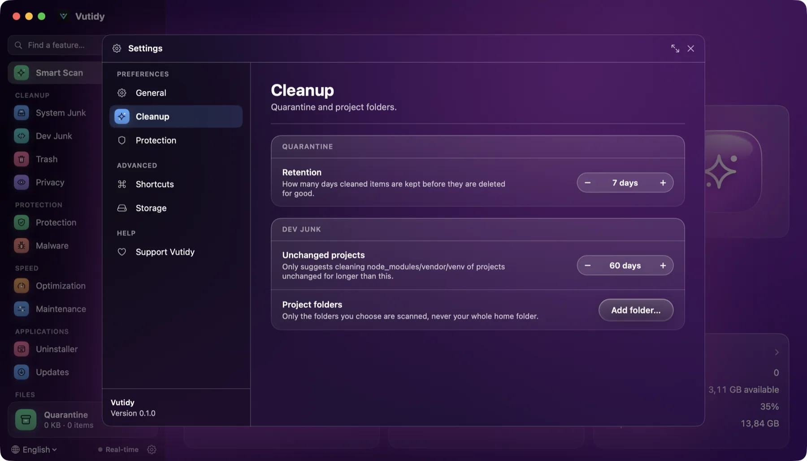
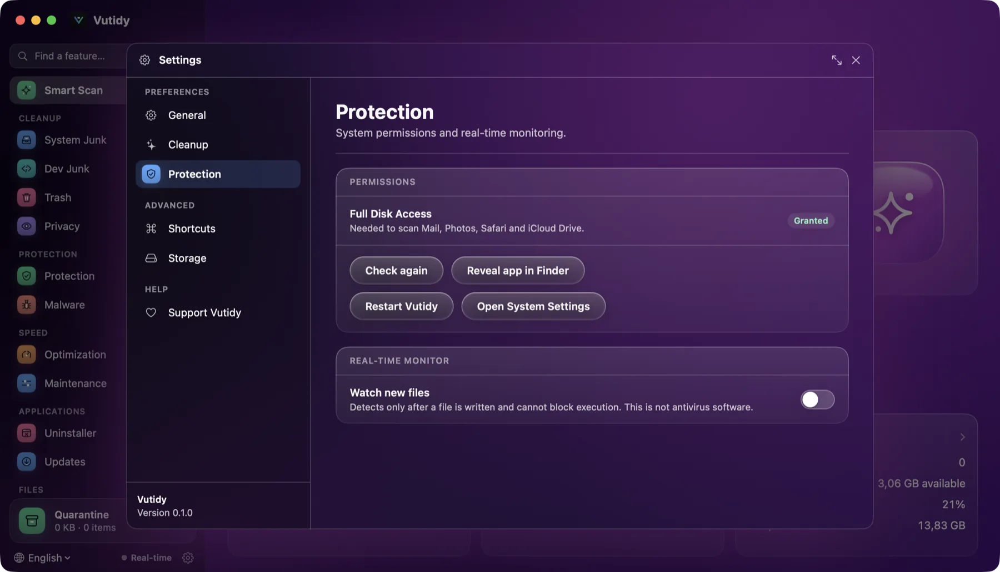
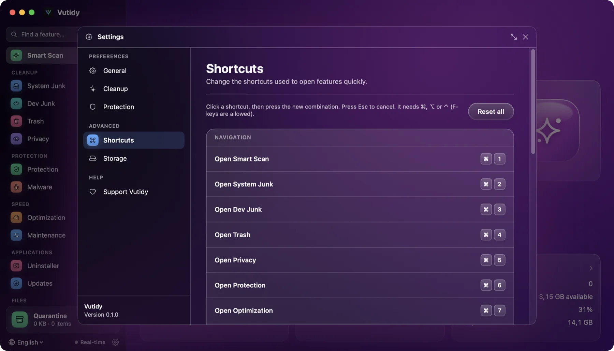
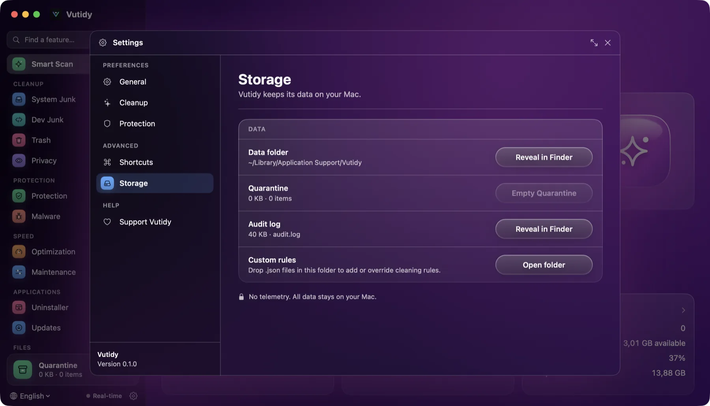
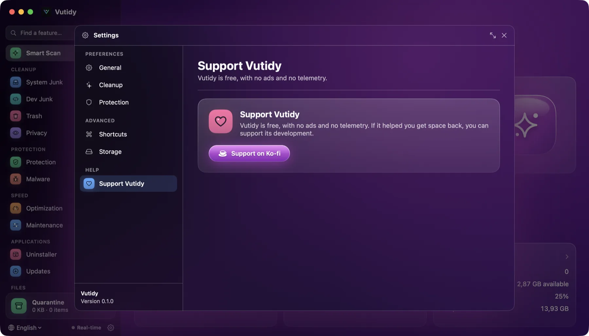

# Settings

Everything you can change in Vutidy, page by page. The layout follows the one in Vutty.

## Contents

- [Open Settings](#open-settings)
- [General](#general)
- [Cleaning](#cleaning)
- [Protection](#protection)
- [Shortcuts](#shortcuts)
- [Storage](#storage)
- [Help and support](#help-and-support)
- [Where preferences are stored](#where-preferences-are-stored)

## Open Settings

Press **⌘,**, choose **Vutidy → Settings…** in the menu bar, or click the gear at the bottom of the sidebar. Settings opens as a **floating window over the app** with a title bar (maximize and close buttons). **Esc**, a click outside it and **×** close it.

The menu on the left has three groups:

| Group | Pages |
| --- | --- |
| **PREFERENCES** | General, Cleaning, Protection |
| **ADVANCED** | Shortcuts, Storage |
| **HELP** | Support Vutidy (donate) and the version |

Changes apply **immediately**; there is no Save button.

## General

*Settings → General.*

| Setting | What it does |
| --- | --- |
| **Updates** | The version you run, **Check**, release notes and **Update and restart** when a new version exists, and **Check for updates automatically** (on by default). See [Updating Vutidy](16-updating-vutidy.md). |
| **Language** | *Automatic* (follows macOS, English if unsupported), *English*, *Tiếng Việt*, *日本語*, *中文*. The whole interface switches at once. See [Languages](12-languages.md). |
| **Reduce motion** | Turns animations and transitions off. |
| **Confirm before cleaning** | On by default. Turn it off to run *Clean* without the confirmation dialog (preview and the safety layer still apply). |
| **Default clean mode** | Quarantine, Trash or Preview only: what the mode menu starts on. |
| **Start real-time monitor at launch** | Turns the [real-time monitor](04-protection.md#real-time-monitor) on when Vutidy opens. |

## Cleaning

*Settings → Cleanup: Quarantine retention and the Dev Junk project folders.*

| Setting | What it does |
| --- | --- |
| **Quarantine retention** | 1 to 60 days (7 by default) before Quarantine items are deleted for good. |
| **Stale project days** | How long a project must be untouched before its `node_modules`, `vendor`, `target`, `.venv` or `Pods` are offered (60 by default). |
| **Project folders** | The folders Dev Junk searches for old project dependencies. **Add folder…** / **Remove**. Vutidy only walks these, never your whole home folder. |

## Protection

*Settings → Protection.*

| Setting | What it does |
| --- | --- |
| **Full Disk Access** | Shows *Granted* or *Not granted*, with **Check again**, **Open System Settings** and **Reveal app in Finder**. |
| **Real-time monitor** | The same switch as in the Protection page, with a reminder that it detects after the fact. |

## Shortcuts

*Settings → Shortcuts. Click a key combination to change it.*

Every action has a default key shown as key caps. Click a key cap, press the new combination and it is saved. The full description is in [Keyboard shortcuts](11-shortcuts.md).

## Storage

*Settings → Storage.*

| Item | What it shows and does |
| --- | --- |
| **Data folder** | `~/Library/Application Support/Vutidy` with **Show in Finder** |
| **Quarantine** | Size and number of items, and **Empty Quarantine** (asks first, cannot be undone) |
| **Audit log** | Its path and size, **Show in Finder** |
| **Custom rules** | The `Rules` folder where your own rule files go, **Open rules folder** |
| **Privacy note** | Vutidy has no telemetry and sends nothing anywhere |

## Help and support

*Settings → Support Vutidy.*

**Support Vutidy** opens the Donate card (a Ko-fi link; see [Support Vutidy](14-support.md)). The **version** of the app is shown at the bottom of the menu.

## Where preferences are stored

Preferences live in the app's standard user defaults (`~/Library/Preferences`): language, reduce motion, confirmation, default mode, retention, project folders, stale days, shortcuts and so on. Data (Quarantine, audit log, rules, speed history) lives in `~/Library/Application Support/Vutidy`; set the environment variable `VUTIDY_HOME` to use another folder.
