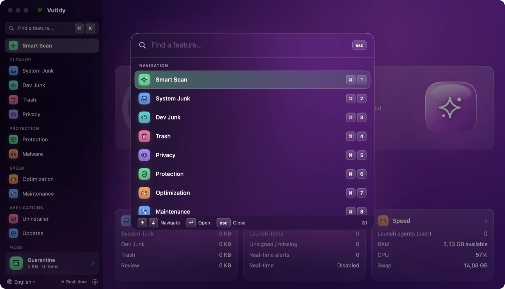
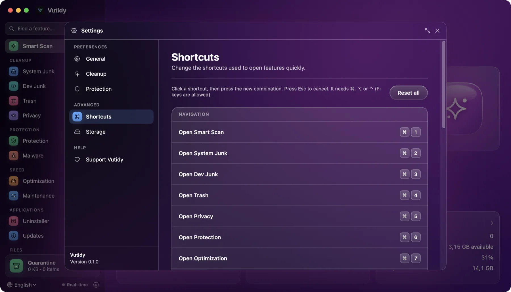

# Keyboard shortcuts

Every page and a few actions have a key you can change in **Settings → Shortcuts**. ⌘ on a Mac is the Command key.

## Contents

- [Default shortcuts](#default-shortcuts)
- [Fixed keys](#fixed-keys)
- [Quick Open](#quick-open)
- [Change a shortcut](#change-a-shortcut)
- [Rules and limits](#rules-and-limits)

## Default shortcuts

**Navigation**

| Keys | Opens |
| --- | --- |
| ⌘ 1 | Smart Scan |
| ⌘ 2 | System Junk |
| ⌘ 3 | Dev Junk |
| ⌘ 4 | Trash |
| ⌘ 5 | Privacy |
| ⌘ 6 | Protection |
| ⌘ 7 | Optimization |
| ⌘ 8 | Maintenance |
| ⌘ 9 | Uninstaller |
| ⌘ ⇧ U | Updates |
| ⌘ ⇧ L | Space Lens |
| ⌘ ⇧ F | Large & Old Files |
| ⌘ ⇧ D | Duplicates |
| ⌘ ⇧ C | Cloud Cleanup |
| ⌘ ⇧ Y | Quarantine |

**Actions**

| Keys | Action |
| --- | --- |
| ⌘ K | Quick Open (search any feature) |
| ⌘ R | Rescan the current page (a cleanup page or Smart Scan) |
| ⌘ ⇧ R | Turn the Real-time Monitor on or off |
| ⌘ , | Open Settings |

Point at a sidebar item to see its shortcut at the right.

## Fixed keys

These cannot be changed:

| Keys | Action |
| --- | --- |
| ⌘ ↩ | Clean the selected items on a cleanup page (the Clean button) |
| Esc | Close Settings, Quick Open or the shortcut recorder |
| ↑ ↓ ↩ | Move and choose in Quick Open |

## Quick Open

*Quick Open (⌘K) lists every page with its shortcut.*

Press **⌘K** to open a search box over the app. Type part of a feature's name (in the current language), move with **↑ ↓**, press **↩** to go there. **Esc** or a click outside closes it. It lists every page with its shortcut, plus the actions (rescan, real-time monitor, settings), so you never have to remember a key.

## Change a shortcut

*Settings → Shortcuts.*

1. Open **Settings → Shortcuts** (⌘,).
2. Click the key caps of an action. They turn blue and wait for a key.
3. Press the new combination. It is saved at once.
4. **Reset** (shown next to a changed shortcut) puts one action back to its default; **Reset all** puts all of them back. **Esc** cancels while it is waiting.

## Rules and limits

- A combination already used by another action is **refused**, and the message names the action that owns it.
- A plain key is refused: use **⌘, ⌥ or ⌃** with it. Function keys (F1–F12) are allowed on their own.
- A few combinations belong to macOS and are refused (⌘Q, ⌘W, ⌘H, ⌘M, ⌘Tab, ⌘Space and similar).
- Shortcuts are stored by physical key position, so they keep working when you switch keyboard layout; the key caps show the US label.
- Shortcuts work while a text field has focus, because they all use a modifier key.
