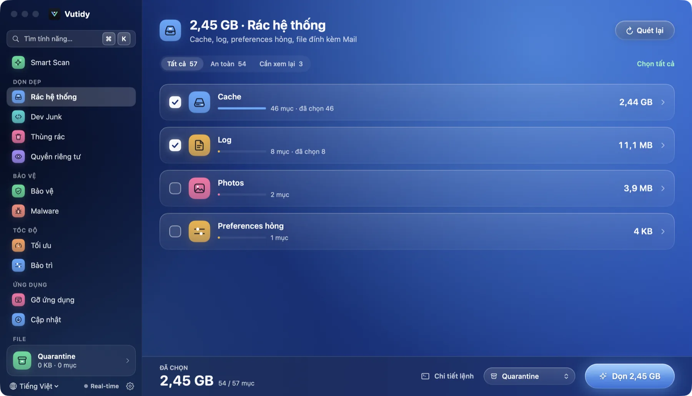
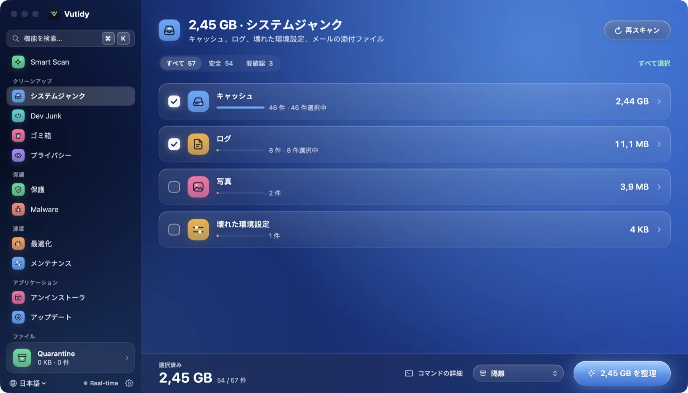
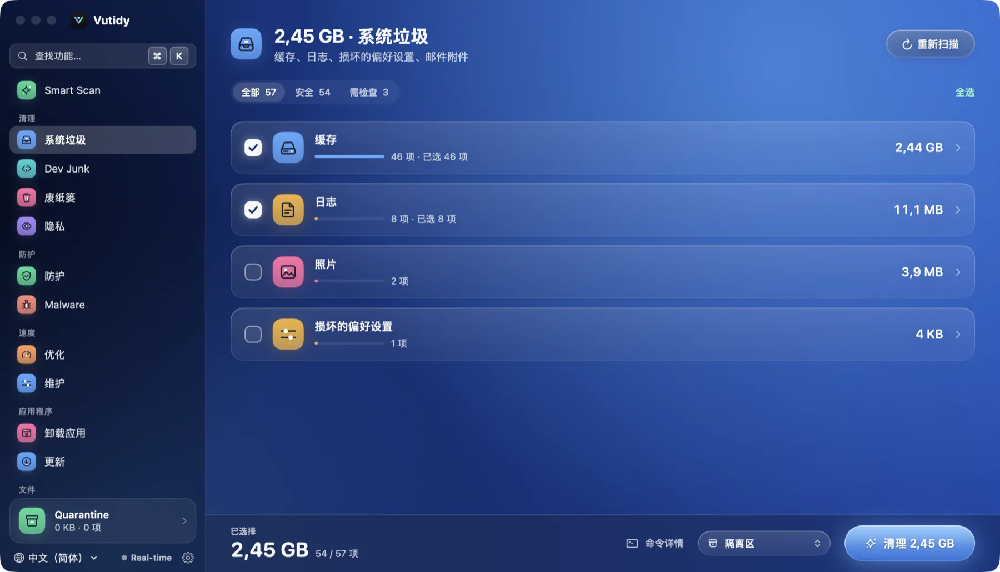

# Languages

Vutidy is available in **English**, **Tiếng Việt**, **日本語** and **中文 (简体)**.

## Contents

- [Choose a language](#choose-a-language)
- [How Automatic works](#how-automatic-works)
- [What is translated](#what-is-translated)
- [How the translations are kept](#how-the-translations-are-kept)

## Choose a language

| Tiếng Việt | 日本語 | 中文 |
| --- | --- | --- |
|  |  |  |

*The same page (System Junk) in the three other languages.*

Use the **globe menu** at the bottom of the sidebar, or **Settings → General → Language**. The whole interface changes at once, including the sidebar, every page, alerts and the menu bar popover. The choice is remembered.

## How Automatic works

*Automatic* (the default) reads your macOS language list and uses the first language Vutidy has: Vietnamese, Japanese, Chinese or English. If none matches, it uses **English**.

## What is translated

All interface text and the descriptions of cleaning rules ("Cache người dùng" becomes "User caches", "ユーザキャッシュ", "用户缓存"). These stay as they are:

- names of products and tools (Docker, JetBrains, Xcode, Homebrew…) and feature names such as *Dev Junk*, *Space Lens* and *Smart Scan*;
- file paths and the commands shown under *Commands to run*;
- text produced by macOS or other tools (an error returned by `launchctl`, for example);
- the **command line tool**, which prints in Vietnamese for now.

Dates and sizes use your system formats. Results already on screen (such as scan details) are produced in the language that was active when they were scanned; scan again after switching to refresh them.

## How the translations are kept

The translations are in `Sources/CoreKit/Localization/` (`English.swift`, `Japanese.swift`, `Chinese.swift`). The lookup key is the original Vietnamese sentence; Vietnamese returns the key itself, and a missing translation falls back to English, then to the key. A unit test checks that every key exists in Japanese and Chinese and that the `%@` placeholders match, so a half-translated build fails. To add a string or a whole language, see the [development guide](../development/development.md#add-or-change-a-translation).
