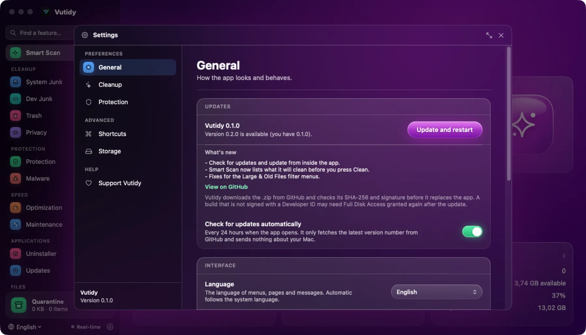

# Updating Vutidy

Vutidy can check for a newer version and install it for you, without leaving the app. This page is about updating **Vutidy itself**. To update the other apps on your Mac, see [Applications → Updates](06-applications.md#updates).

## Contents

- [Check for a new version](#check-for-a-new-version)
- [Update from the app](#update-from-the-app)
- [Automatic checks](#automatic-checks)
- [What Vutidy checks before it installs](#what-vutidy-checks-before-it-installs)
- [When the update button does not work](#when-the-update-button-does-not-work)
- [Full Disk Access after an update](#full-disk-access-after-an-update)
- [Privacy](#privacy)

## Check for a new version

Open **Settings → General** (⌘,). The **Updates** card at the top shows the version you are running and, below it, the result of the last check.

*Settings → General → Updates. A new version is available: its release notes and the **Update and restart** button appear.*

You can also choose **Vutidy → Check for Updates…** in the menu bar. It opens the same card and starts a check.

| What the card says | What it means | Button |
| --- | --- | --- |
| *Not checked yet.* / *Last checked: …* | Nothing new is known. | **Check** |
| *You have the latest version.* | You run the newest release. | **Check** |
| *Version X is available (you have Y).* | A newer release exists. The notes of that release are shown under **What's new**. | **Update and restart** |
| *Downloading… n%* | The new version is coming in. | a progress bar |
| *Verifying and installing…* | Checks are running (see below). | a spinner |
| A red message | Something went wrong; nothing was changed. See [When the update button does not work](#when-the-update-button-does-not-work). | **Check** |

## Update from the app

1. Open **Settings → General** and, when a version is available, read **What's new**. **View on GitHub** opens the full release page.
2. Press **Update and restart**.
3. Vutidy downloads the new version, checks it, and closes. A moment later the new version opens by itself.

You do not need to drag anything into *Applications*. Your settings, shortcuts and Quarantine are kept: they live outside the app (see [Settings → where preferences are stored](10-settings.md#where-preferences-are-stored)).

> If Vutidy is in the middle of a scan or a clean, wait for it to finish before you update.

## Automatic checks

By default Vutidy checks **once every 24 hours**, a few seconds after it opens. If a newer version exists, a notification appears in the bottom-right corner with an **Update now** button that takes you to the card above. If there is nothing new, or the check fails (for example you are offline), it says nothing.

Turn this off with **Check for updates automatically** in the same card. The **Check** button and the menu item keep working.

Automatic checks only run when Vutidy is started as the real app (`Vutidy.app`). A copy started with `swift run` does not check by itself.

## What Vutidy checks before it installs

Updating replaces the app that is running, so Vutidy is strict. It stops, changes nothing and shows a message if any of these fail:

| Check | Why |
| --- | --- |
| The release has a **SHA256SUMS** file, and the SHA-256 of the downloaded `.zip` matches it | The file was not damaged or swapped on the way. A release without checksums is **refused**. |
| The app inside the zip has the **same bundle ID** (`com.vutidy.app`) and the **version number** of the release | It is really Vutidy, and really that version. |
| The **code signature** is valid | The app was not modified after it was built. |
| If your Vutidy is signed with an Apple Developer ID, the new one has the **same Team ID** | Only the same developer can update it. |

Only after all of that does Vutidy copy the new app next to the current one and swap them. If the swap fails, the old app is put back and opened again.

Every update is written to the [audit log](08-quarantine-and-safety.md#the-audit-log).

## When the update button does not work

| Message | What to do |
| --- | --- |
| *Could not reach GitHub* | Check your connection and press **Check** again. |
| *The SHA-256 of the download does not match* | The file was discarded. Try again later; if it keeps happening, download the `.dmg` from the [Releases page](https://github.com/vunguyenvu35/vutidy/releases/latest) and check it with `SHA256SUMS`. |
| *The release has no SHA256SUMS* | Vutidy will not install an unverifiable file. Update by hand with the `.dmg`. |
| *Drag Vutidy into the Applications folder…* | You opened Vutidy from the disk image (or from a quarantined download). Copy it to *Applications*, open it from there, then update. |
| *No permission to write to …* | Your user cannot change the folder Vutidy is in. Update by hand with the `.dmg`, or move Vutidy to `~/Applications`. |
| *Updating only works when running Vutidy.app* | You started a `swift run` build. Rebuild it from the source, or use the app from `scripts/make-app.sh`. |

To update by hand, download `vutidy-macos.dmg` from the [Releases page](https://github.com/vunguyenvu35/vutidy/releases/latest), quit Vutidy (**⌥⌘Q**) and drag the new **Vutidy** onto *Applications*, replacing the old one.

## Full Disk Access after an update

macOS keeps **Full Disk Access** across updates only for an app that is signed with the same identity every time. Releases signed with an Apple Developer ID keep it. A release that is only ad-hoc signed counts as a different app after each update, so the permission has to be granted again (see [Getting started → Full Disk Access](01-getting-started.md#full-disk-access)). The **What's new** panel reminds you of this.

## Privacy

A check is one public request to GitHub for the list of Vutidy releases. It sends no identifier, no list of your files or apps, and nothing about your Mac beyond what any web request carries (your IP address and a `Vutidy/<version>` user agent). There is no Vutidy server. If you want no request at all, turn off **Check for updates automatically** and do not press **Check**.
