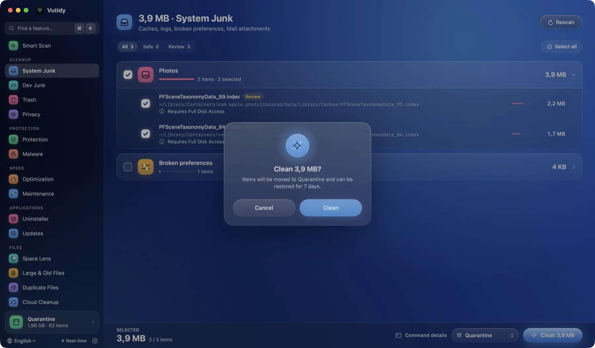
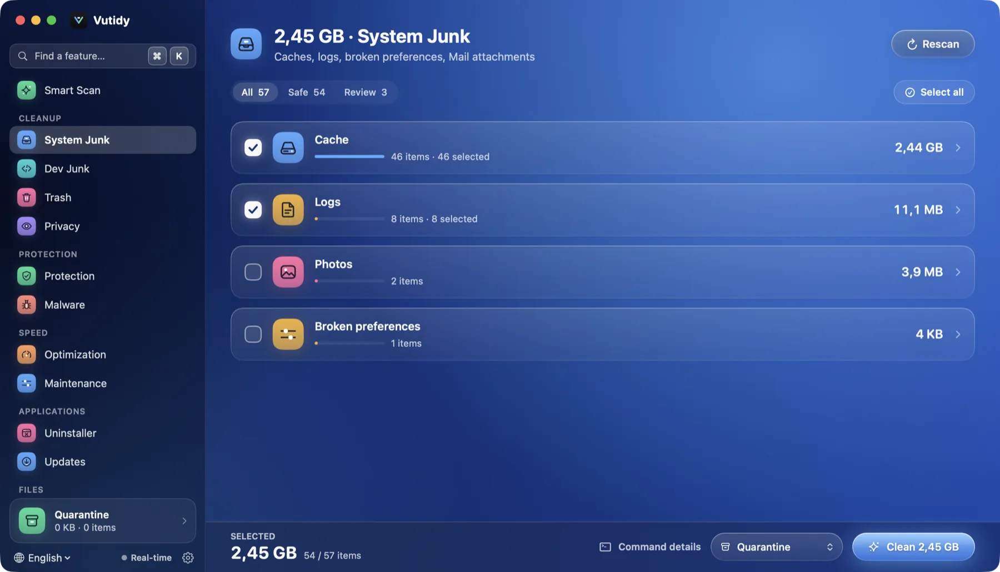
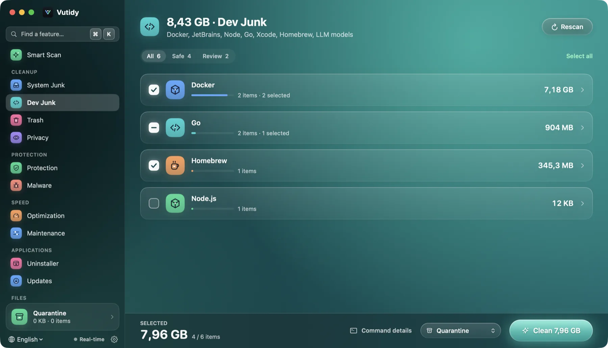
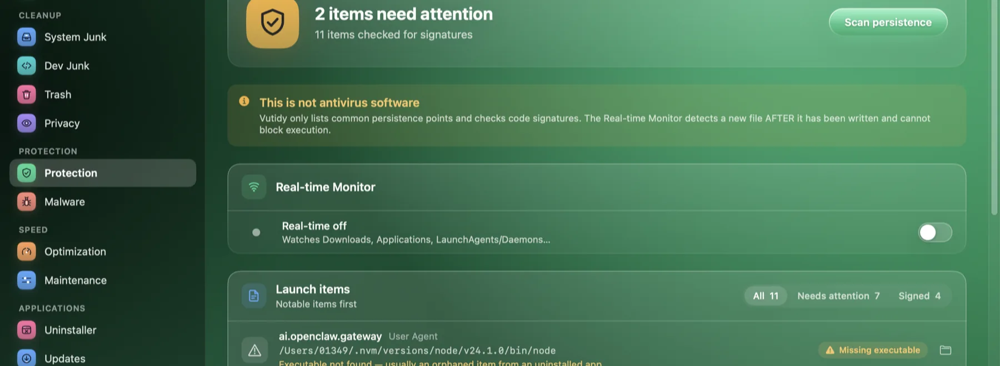
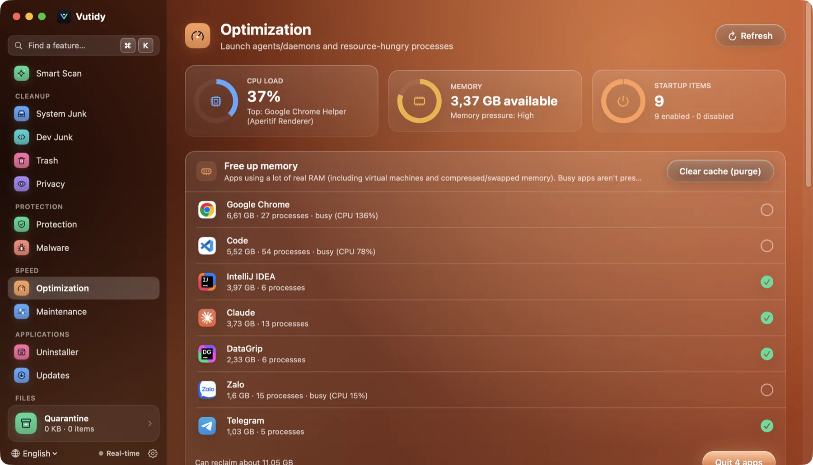
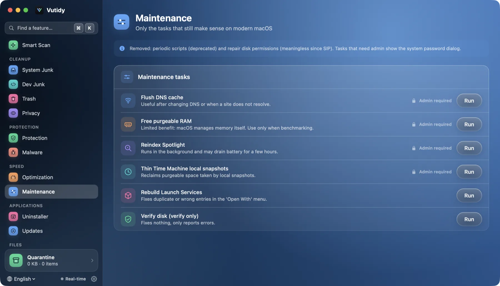
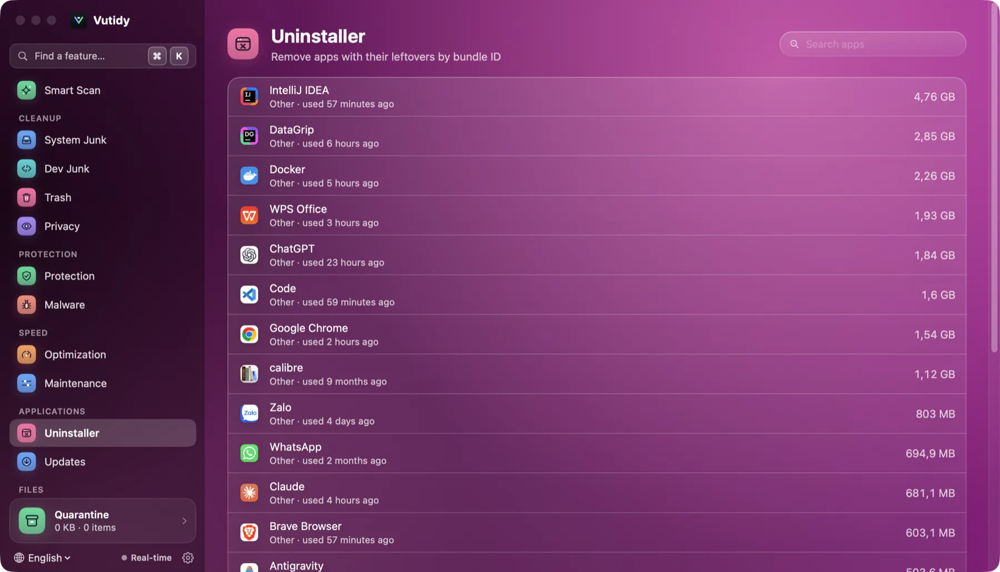
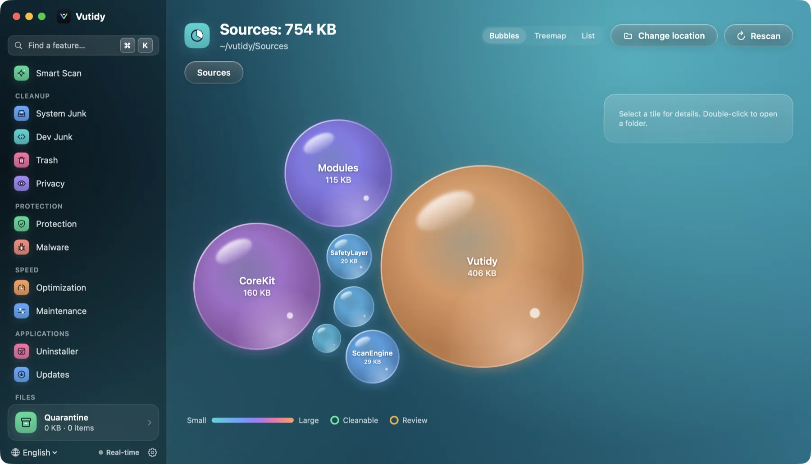
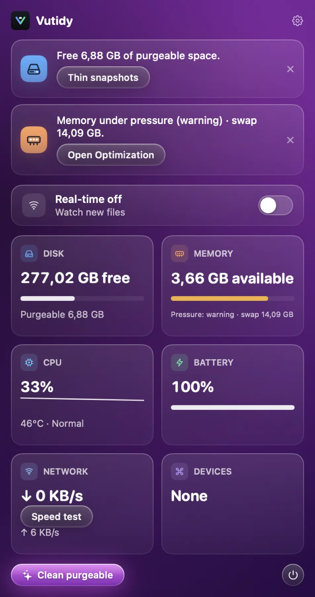

# Vutidy user guide

A guide to every screen of Vutidy, from your first scan to shortcuts, languages and the command line.

> New here? Start with [Getting started](01-getting-started.md), then run a **Smart Scan** in *Preview only* mode and read what it would do.

## Chapters

| # | Chapter | What it covers |
| --- | --- | --- |
| 1 | [Getting started](01-getting-started.md) | Install, the main window, Full Disk Access, your first scan |
| 2 | [Smart Scan](02-smart-scan.md) | One scan for junk, protection and speed; cleaning the safe items |
| 3 | [Cleanup](03-cleanup.md) | System Junk, Dev Junk, Trash, Privacy; safety levels, clean modes, the action bar |
| 4 | [Protection](04-protection.md) | Persistence scanner, the real-time monitor and its limits |
| 5 | [Speed](05-speed.md) | Optimization (gauges, heavy processes, startup items) and Maintenance |
| 6 | [Applications](06-applications.md) | Uninstaller with leftovers, Updates |
| 7 | [Files](07-files.md) | Space Lens, Large & Old Files, Duplicates, Cloud Cleanup |
| 8 | [Quarantine and safety](08-quarantine-and-safety.md) | The blocklist, undo, retention, the audit log, what is never touched |
| 9 | [Menu bar](09-menu-bar.md) | The popover: recommendations, monitors, speed test, devices |
| 10 | [Settings](10-settings.md) | Every Settings page |
| 11 | [Keyboard shortcuts](11-shortcuts.md) | Every default key, changing them, Quick Open |
| 12 | [Languages](12-languages.md) | English, Tiếng Việt, 日本語, 中文 |
| 13 | [Command line](13-cli.md) | `vutidy-cli` |
| 14 | [Support Vutidy](14-support.md) | Where the Donate card is |
| 15 | [Troubleshooting](15-troubleshooting.md) | Common problems, where your data lives |
| 16 | [Updating Vutidy](16-updating-vutidy.md) | Check for a new version, update from the app, what is verified |

## Screen tour

Every page at a glance. Click a title to open its chapter.

| | | |
| --- | --- | --- |
| **[Smart Scan](02-smart-scan.md)**  | **[System Junk](03-cleanup.md#how-a-cleanup-page-works)**  | **[Dev Junk](03-cleanup.md#dev-junk)**  |
| **[Protection](04-protection.md)**  | **[Optimization](05-speed.md)**  | **[Maintenance](05-speed.md#maintenance)**  |
| **[Uninstaller](06-applications.md)**  | **[Space Lens](07-files.md#space-lens)**  | **[Menu bar](09-menu-bar.md)**  |

## I want to…

| Task | Go to |
| --- | --- |
| See what would be cleaned without deleting anything | [Preview only](03-cleanup.md#clean-modes) |
| Get back something I cleaned by mistake | [Restore from Quarantine](08-quarantine-and-safety.md#undo) |
| Free space used by Docker, Xcode or `node_modules` | [Dev Junk](03-cleanup.md#dev-junk) |
| Find the biggest folders | [Space Lens](07-files.md#space-lens) |
| Remove an app and everything it left behind | [Uninstaller](06-applications.md#uninstaller) |
| Stop an app from starting at login | [Startup items](05-speed.md#startup-items) |
| Jump to any feature from the keyboard | [Quick Open](11-shortcuts.md#quick-open) |
| Change a shortcut | [Change a shortcut](11-shortcuts.md#change-a-shortcut) |
| Update Vutidy to a new version | [Updating Vutidy](16-updating-vutidy.md) |
| Switch the interface language | [Languages](12-languages.md) |
| Run a scan from a script | [Command line](13-cli.md) |
| Use Vutidy from a terminal over SSH | [Command line](13-cli.md) |
